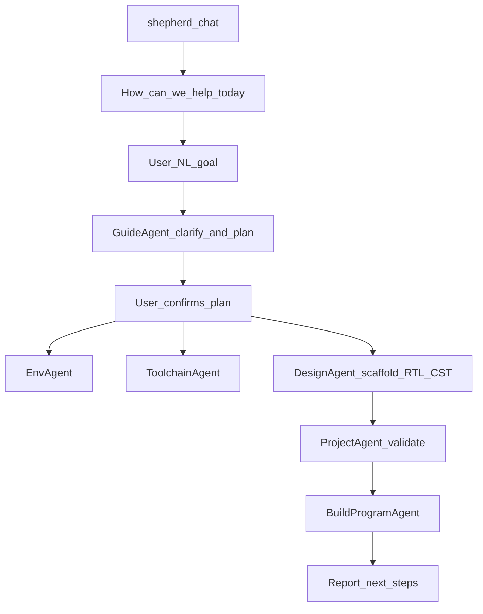
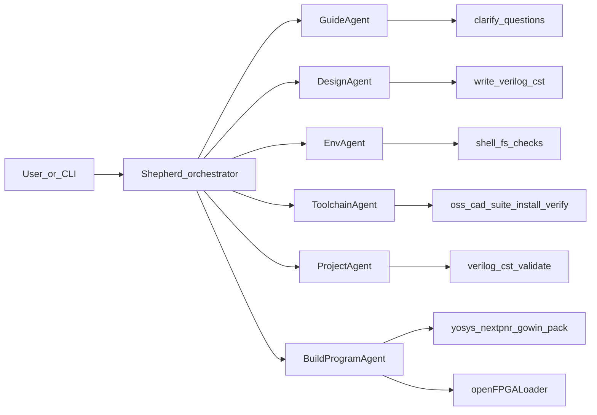

# FPGA Shepherd — Multi-Agent FPGA Programming Toolkit

## Goal

Ship a **hackathon-ready, reusable tool** that helps people **build Tang Nano 9K projects quickly from natural language**.

The user opens Shepherd, we ask something like **“How can we help you today?”**, they say e.g. *“help me read IMU sensor data on my Tang Nano 9K”*, and Meta Llama–powered agents **clarify → scaffold → validate → build → program** via CLI.

Colleagues and later users can run it, fork it, and add new agents/tools. **v0 board support: Tang Nano 9K only.**

## Product shape

A small **Python CLI package** (`fpga-shepherd` / `shepherd`) that:

- Starts an **interactive guided session** (prompt + clarifying questions), not only one-shot commands
- Talks to **Meta Llama** (`META_API_KEY` + `META_BASE_URL` + model id via env)
- Runs **independent specialist agents** with shared tool interfaces
- Executes FPGA work through **OSS CAD Suite CLI** (not the Lushay VS Code UI)
- Is easy to extend: new agent = new module + tool registrations + prompt

Lushay Code remains an optional human UX note in docs; agents do not drive the extension UI.

## Primary user journey (what we optimize for)



Example:

1. Shepherd: *How can we help you today?*
2. User: *Help me read IMU sensor data on my Tang Nano 9K.*
3. GuideAgent asks only what’s needed, e.g.:
   - Which IMU / interface (I2C? SPI? module name if known)?
   - Which pins / PMOD / header?
   - Output preference (LEDs, UART serial, both)?
   - New project path or existing folder?
4. Shepherd proposes a short plan (files to create, pins, build/program).
5. After user OK: scaffold Verilog + `.cst` → validate → build → program Tang Nano 9K.
6. Report success / errors and what to try next (e.g. open serial monitor).

Direct commands (`doctor`, `validate`, `build`, `program`) remain available for power users and for testing agents in isolation.

## Agent map (independent, step-aligned)



| Agent | Role | Responsibility | Acts via |
| --- | --- | --- | --- |
| **Shepherd** | Orchestrator + session host | Ask how we can help; route to specialists; keep structured session context; final human-readable report | Agent dispatch + interactive prompts |
| **GuideAgent** | Intent → plan | Parse NL goal; ask clarifying questions; produce a confirmed build plan (interfaces, pins, artifacts, success criteria). **Tang Nano 9K only** — refuse/redirect other boards | Chat + structured plan object |
| **DesignAgent** | Scaffold project | From confirmed plan, create/update project dir: `top.v` (+ modules), `.cst`, README snippet for the design | File write tools; board pin knowledge for Tang Nano 9K |
| **EnvAgent** | Step 1 (adapted) | Check Cursor/VS Code + optional Lushay Code; report readiness. Does not block CLI flow if extension missing | `cursor`/`code` extension list/install when available |
| **ToolchainAgent** | Step 2 | Detect/install/verify OSS CAD Suite; ensure `yosys`, `nextpnr-*`, `gowin_pack`, `openFPGALoader` | Download/extract, config path, smoke-test binaries |
| **ProjectAgent** | Step 3 | Validate project: ≥1 `.v`, ≥1 `.cst`, top module (`top` default), pin sanity | Filesystem + heuristics + fix suggestions |
| **BuildProgramAgent** | Step 4 | Synthesize → P&R → pack → program; diagnose logs; safe retries | `yosys`, nextpnr, `gowin_pack`, `openFPGALoader -b tangnano9k` |

Each specialist is **independently invokable** (`shepherd run guide`, `shepherd run design`, …) and also used inside `shepherd chat` / `shepherd run`.

## Board constraint (v0)

- **Supported: Tang Nano 9K only** (`GW1NR-LV9QN88PC6/I5`, `openFPGALoader -b tangnano9k`)
- If the user names another board, GuideAgent explains v0 supports Tang Nano 9K only and continues only if they agree to target that board
- Pin/constraint templates and DesignAgent knowledge are Tang Nano 9K–specific

## Default technical decisions

- **Language**: Python 3.11+
- **LLM**: Meta Llama via OpenAI-compatible HTTP client. Abstract behind `llm/client.py`
- **Agent loop**: Lightweight ReAct-style loop (model ↔ tools ↔ observation), one loop per agent — no heavy framework lock-in
- **Interaction**: `shepherd chat` is the default happy path (readline / prompt_toolkit style Q&A)
- **OS**: macOS + Linux for v0; Windows later
- **Secrets**: `.env.example` only; never commit keys

## Session context (handoff object)

Shared across agents:

```text
{
  goal,                 # original user prompt
  answers,              # Q&A from GuideAgent
  plan,                 # confirmed steps + interfaces + pins
  project_path,
  board: "tangnano9k",
  oss_cad_path,
  artifacts,            # .v / .cst / .fs paths
  errors
}
```

## Proposed repo layout

```text
PLAN.md
README.md
pyproject.toml
.env.example
src/shepherd/
  __init__.py
  cli.py
  llm/client.py
  agents/
    base.py
    shepherd.py           # orchestrator + chat host
    guide.py              # NL goal + clarifying questions
    design.py             # scaffold Verilog + .cst
    env.py
    toolchain.py
    project.py
    build_program.py
  tools/
    shell.py
    oss_cad.py
    project_fs.py
    fpga_build.py
    fpga_program.py
    board_tangnano9k.py   # pin / constraint helpers
  knowledge/
    tangnano9k.md         # board facts for Guide/Design prompts
  config.py
examples/button_led/      # minimal fixture + guided-flow demo target
docs/extending.md
```

## Core CLI flows

1. `shepherd chat` — **primary**: “How can we help you today?” → guide → (optional) scaffold → validate → build → program  
2. `shepherd doctor` — Env + Toolchain checklist  
3. `shepherd validate --project PATH`  
4. `shepherd build --project PATH`  
5. `shepherd program --project PATH` — build + load (SRAM default; `--flash` optional)  
6. `shepherd run --goal "..."` — non-interactive pipeline when goal + enough flags are provided  

## Build/program command skeleton

1. `yosys -p "read_verilog …; synth_gowin -top top -json out.json"`
2. `nextpnr-himbaechel` (or suite Gowin nextpnr) + device + `.cst`
3. `gowin_pack -d GW1N-9C -o design.fs …`
4. `openFPGALoader -b tangnano9k design.fs`

## Extensibility

- Stable **Tool** protocol: name, JSON schema, `run(**kwargs) -> ToolResult`
- Stable **Agent** protocol: `name`, `system_prompt`, `tools`, `run(goal, context) -> AgentResult`
- Later boards = new `knowledge/` + `board_*.py` + GuideAgent allowlist update
- Example stub in docs (e.g. `SimAgent` / UART listen)

## Out of scope for v0

- Boards other than Tang Nano 9K
- Driving Lushay Code UI / Computer Use
- Windows installer polish
- Fully autonomous hardware bring-up with no user confirmation on pin choices
- Cloud/Lushay cloud builds
- Guaranteeing every sensor datasheet is correct without user confirmation (GuideAgent must ask)

## Implementation order

1. Write / update **`PLAN.md`** (this document)
2. Scaffold Python package + CLI + Meta LLM client + `.env.example`
3. Implement tools (shell, OSS CAD, project FS, build, program, Tang Nano 9K board helpers)
4. Implement specialists: Guide, Design, Env, Toolchain, Project, BuildProgram + Shepherd chat host
5. Example project + `README.md` quickstart (include IMU-style guided example in docs)
6. Smoke-test: `chat` / `doctor` → `validate` → `build`; `program` when board connected

## Success criteria

- User can start `shepherd chat`, state a Tang Nano 9K goal in plain language, answer a few questions, and get a scaffolded + buildable project
- Teammate can clone, set Meta API key, run `shepherd doctor` and understand what’s missing
- Each agent runnable alone; full pipeline programs Tang Nano 9K when hardware + suite present
- Clear extension path for a fifth/sixth agent without rewriting the core loop
- Meta model usage is explicit and central

## Human toolchain reference (agents use CLI equivalents)

1. Optional editor extension (Lushay Code) for humans
2. OSS CAD Suite
3. Project with Verilog + `.cst`
4. Build and program (yosys → nextpnr → gowin_pack → openFPGALoader)
