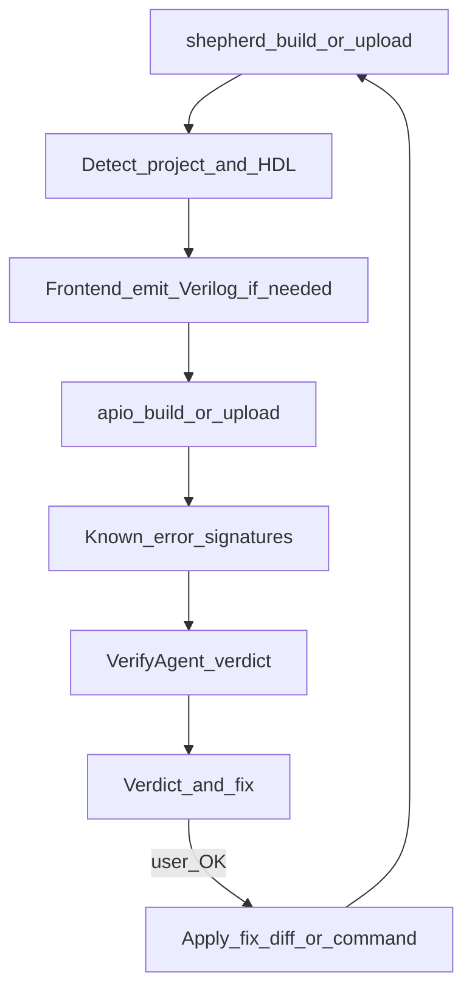

# FPGA Shepherd — AI devkit layer on top of apio

## Goal

Ship a **hackathon-ready devkit** for people who already write RTL: they bring their own design, Shepherd takes care of the annoying parts around it.

Shepherd is a **thin, transparent layer on top of [apio](https://fpgawars.github.io/apio/docs)**. apio already installs and pins the open toolchain, knows boards, and runs build / upload / lint / sim. Shepherd adds what apio does not do:

1. **Right front end for your HDL** — Verilog/SystemVerilog go straight to apio; Amaranth (and later VHDL, SpinalHDL, Chisel) are elaborated to Verilog first, then handed to apio
2. **Failure diagnosis** — turn Yosys / nextpnr / openFPGALoader (via apio) output into a cause + concrete fix (Meta Llama, after deterministic matchers)
3. **Environment fixing** — drivers, udev, USB detection, apio packages; propose the exact command, run it with the user’s OK
4. **Project adoption** — point Shepherd at an existing repo; it detects HDL, top module and sources and writes `apio.ini`

**Audience:** competent FPGA / digital-design engineers. Not a “describe your idea in English” app builder.
**v0 board support: Tang Nano 9K only** (apio board id `sipeed-tang-nano-9k`). Board/part/programmer facts come **exclusively from apio** — Shepherd does not ship board or pin YAML registries.

## Pitch

> You write the RTL — in whatever HDL you use. Shepherd picks the right front end, builds and flashes through apio, and when something breaks it tells you why and how to fix it.

## Design principles

- **apio does the toolchain and board work.** Shepherd never re-implements synthesis, P&R, packing, programming, or board/pin databases. Bugs or missing boards in apio go upstream, not into Shepherd
- **Call the apio CLI, don’t import its internals.** apio is driven as a subprocess; its Python internals are not a stable API. Minimum apio version pinned and checked by `doctor`
- **Transparent by default.** Every command Shepherd runs is printed; raw apio output is always shown (or one flag away). The AI verdict comes *after* the raw log, never instead of it
- **Deterministic first, AI second.** Front-end choice, flags and known error signatures are plain code. Meta Llama explains, prioritizes and handles the long tail — it never silently picks flags
- **Never mutate the user’s project without consent.** AI-proposed edits (`.cst`, `apio.ini`, source) are shown as diffs and applied only on confirmation
- **Works offline.** `--no-ai` runs everything except explanations; deterministic checks still fire
- **Passthrough always available.** `shepherd apio -- <args>` runs raw apio in the project context

## Product shape

A small **Python CLI package** (`fpga-shepherd`, command `shepherd`):

- Command surface mirrors apio (`build`, `upload`, `lint`, `sim`, `test`, `report`) so muscle memory transfers; Shepherd adds pre-steps (front end) and post-steps (verify + diagnose)
- Talks to **Meta Llama** (`META_API_KEY` + `META_BASE_URL` + model id via env), OpenAI-compatible client
- Uses **`uv`** for its own env; **apio is a pinned dependency** of the package (`uv add apio`), so `uv run shepherd` always gets a known apio version
- Machine-readable output (`--json`) for CI and editor integrations
- Extensible: new front end / error signature / agent = new module + registration

## Primary flow



Example (experienced user, existing Verilog repo):

```text
$ shepherd build
→ detected: SystemVerilog, top=blinky, board=sipeed-tang-nano-9k   # from apio.ini
$ apio build -p .
... raw apio output ...
→ verdict: FAIL  (signature: nextpnr-unconstrained-io)
   cause: port `uart_tx` has no IO_LOC in tangnano9k.cst
   fix:   add `IO_LOC "uart_tx" 17;` (on-board USB-UART TX) — apply? [y/N]
```

Pin / constraint / board mistakes are surfaced by **apio / nextpnr / openFPGALoader** and interpreted by VerifyAgent — Shepherd does not pre-validate against a local pin database.

## Auto-check policy (VerifyAgent)

After **every** `build`, `upload`, `lint`, `test` (and on demand via `shepherd check`), Shepherd runs VerifyAgent unless `--no-check`.

| After | Deterministic facts | AI adds |
| --- | --- | --- |
| **front end** | emitter exit code, Verilog produced, top module present | why elaboration failed, in source terms |
| **build** | apio exit code, bitstream exists & non-empty, utilization/timing from `apio report` | cause + fix for synth/P&R failures; retry with `--verbose-synth` / `--verbose-pnr` when output is too thin |
| **upload** | openFPGALoader output (via apio), `apio devices` scan, SRAM vs flash | driver / udev / cable / board-mode fixes |
| **lint / test** | Verilator / testbench exit codes | grouped, deduplicated findings |

Rules:

- Verdict is `pass` / `warn` / `fail` + fix list; `fail` stops the pipeline
- Known error signatures (`knowledge/errors/*.yaml`, regex + explanation + fix) are matched **before** calling the LLM; an LLM-diagnosed error that recurs is a candidate for a new signature
- The LLM gets: the command run, trimmed logs, `apio.ini`, `.cst`, and relevant source snippets — never the whole repo by default
- `shepherd explain [LOGFILE]` diagnoses the last run or any pasted log

## Agents (small, step-aligned)

Fewer agents than a chat-app design: most of the pipeline is deterministic tools; agents exist where judgment helps.

| Agent | Responsibility | Acts via |
| --- | --- | --- |
| **Shepherd** (orchestrator) | Run the pipeline for a command; always invoke VerifyAgent after steps; write the run record | Tool dispatch, no chat by default |
| **DoctorAgent** | Check Python/uv, apio version, `apio packages`, drivers, udev, connected devices; propose exact fix commands | `apio packages list/install`, `apio drivers install`, `apio devices`, shell checks |
| **AdoptAgent** | Adopt an existing repo: detect HDL(s), candidate top modules, sources/testbenches, `.cst`; propose `apio.ini` + `shepherd.toml` | Filesystem scan + `apio create -b … -t …` |
| **VerifyAgent** | Verdict after each step: deterministic facts + signature match + Meta Llama diagnosis | Log parsers, `apio report`, signature DB |

Board identity comes **exclusively from apio** (`apio.ini` / `apio boards`). v0 only accepts apio board id `sipeed-tang-nano-9k`. No Shepherd board or pin YAML.

`shepherd ask "..."` is an optional Q&A mode with the project and last run as context (e.g. “why is fmax 27 MHz?”). It is a helper, not the main entry point.

## Front ends (“right compiler”)

| HDL | v0 path | Status |
| --- | --- | --- |
| Verilog (`.v`) | apio directly | v0 |
| SystemVerilog (`.sv`) | apio directly (apio/Yosys SV support) | v0 — verify which SV constructs the bundled Yosys accepts; surface clear errors |
| Amaranth (`.py`) | Amaranth elaborate → Verilog into staging dir → apio | v0 |
| VHDL | GHDL synth → Verilog (or ghdl-yosys-plugin) → apio | stretch — verify GHDL availability alongside apio packages |
| SpinalHDL / Chisel | run user’s generator → Verilog → apio | later |

Mixed-language projects: each non-Verilog source is emitted to Verilog, then everything is built as one apio project.

**Staging:** generated projects live in `.shepherd/build/` (generated `.v` + copied `.cst` + generated `apio.ini`) so the user’s tree stays clean. Plain Verilog/SV projects use the user’s own `apio.ini` in place.

apio facts to respect (from apio 1.6 CLI): build picks up project sources in lexicographic order, ignores `*_tb.v` / `*_tb.sv`, top module comes from `apio.ini` `top-module`; `apio upload` builds implicitly.

## Boards (apio owns this exclusively)

- **No** `boards.yaml`, **no** `lib/pins/*.yaml`, **no** Shepherd board registry
- Project board id lives in **`apio.ini`** (v0: `sipeed-tang-nano-9k` only). Shepherd validates via apio (`apio boards` / project config)
- Pin / part / programmer knowledge: use apio’s [supported boards](https://fpgawars.github.io/apio/docs/supported-boards/) and toolchain errors
- Adding another board later = when apio supports it and we lift the v0 allowlist — no Shepherd catalog to maintain

## Project config

- **`apio.ini`** stays apio’s file (board, top-module, envs). Shepherd reads/writes it but does not add custom keys
- **`shepherd.toml`** (optional) holds Shepherd-only settings: front end per source glob, staging on/off, AI on/off, extra context files

```toml
[frontend]
amaranth = { entry = "rtl/top.py:Top" }

[checks]
ai = true
```

## Run record (replaces chat session context)

Every run writes `.shepherd/runs/<timestamp>.json`:

```text
{
  command,            # e.g. build
  project_path,
  board,              # apio board id (e.g. sipeed-tang-nano-9k)
  hdl,                # detected languages
  steps: [            # frontend | apio | verify
    { name, cmd, exit_code, log_path, duration }
  ],
  artifacts,          # emitted .v, .cst, bitstream
  verdict,            # pass | warn | fail
  findings,           # signature matches + AI diagnosis + proposed fixes
  apio_version
}
```

`shepherd explain` and `shepherd ask` read the latest run record.

## CLI

| Command | Does |
| --- | --- |
| `shepherd doctor [--fix]` | Env + apio + packages + drivers + devices checklist; `--fix` proposes/runs fixes with confirmation |
| `shepherd init [PATH]` | Adopt existing repo (AdoptAgent) or create a minimal project; writes `apio.ini` (+ `shepherd.toml` if needed) |
| `shepherd build` | Front end → `apio build` → verify |
| `shepherd upload [--flash]` | Front end → `apio upload` → verify |
| `shepherd lint` / `sim` / `test` / `report` | Front end → matching apio command → verify where useful |
| `shepherd check --stage …` | VerifyAgent on the last run |
| `shepherd explain [LOG]` | Diagnose last failure or any log |
| `shepherd ask "…"` | Optional Q&A with project + last run as context |
| `shepherd apio -- <args>` | Raw apio passthrough |

Global flags: `--no-ai`, `--no-check`, `--json`, `--dry-run` (print commands only), `-v` (stream raw output).

## Default technical decisions

- **Language**: Python 3.11+
- **Env / packaging**: **`uv`** only (`uv sync`, `uv add`, `uv run`); `uv.lock` committed
- **Toolchain + boards**: apio exclusively (pinned, `>=1.6,<2`); packages via `apio packages install`
- **LLM**: Meta Llama via OpenAI-compatible HTTP client behind `llm/client.py`
- **Agent loop**: lightweight ReAct-style loop per agent; no heavy framework
- **OS**: macOS + Linux for v0; Windows later
- **Secrets**: `.env.example` only; never commit keys

### How teammates start

```bash
cd FPGA-shepherd
uv sync
cp .env.example .env        # set META_API_KEY
uv run shepherd doctor      # installs/validates apio packages with your OK
cd examples/blinky_sv && uv run shepherd upload
```

## Proposed repo layout

```text
PLAN.md
README.md
pyproject.toml              # uv-managed; depends on apio
uv.lock
.env.example
src/shepherd/
  __init__.py
  cli.py
  config.py                 # shepherd.toml + apio.ini read/write
  runs.py                   # run records
  llm/client.py
  apio/
    runner.py               # subprocess wrapper, version check, log capture
    parse.py                # apio / yosys / nextpnr / openFPGALoader output parsing
  frontends/
    base.py                 # Frontend protocol: detect(), emit() -> Verilog
    verilog.py              # passthrough (.v / .sv)
    amaranth.py
    vhdl.py                 # stretch
  checks/
    artifacts.py            # bitstream / log artifact presence checks
  agents/
    base.py
    shepherd.py             # orchestrator
    doctor.py
    adopt.py
    verify.py
  knowledge/
    tangnano9k.md           # optional prose for LLM context (not a pin DB)
    errors/                 # known error signatures (regex → cause → fix)
      yosys.yaml
      nextpnr.yaml
      openfpgaloader.yaml
examples/
  blinky_sv/                # plain SV, apio.ini
  uart_amaranth/            # Amaranth front end
  broken/                   # intentionally broken projects for demo + tests
docs/extending.md           # new front end / signature / agent (boards via apio)
```

## Extensibility

- **Frontend** protocol: `detect(project) -> bool`, `emit(project, out_dir) -> list[Path]`
- **Error signature**: YAML entry (tool, regex, cause, fix template) — no code
- **Agent** protocol: `name`, `system_prompt`, `tools`, `run(context) -> AgentResult`
- **Board**: apio board id only (`apio.ini` / `apio boards`)

## Out of scope for v0

- Re-implementing anything apio does (toolchain install, synth/P&R, programming, board/pin databases)
- Shepherd-owned pin or board YAML
- Natural-language → design scaffolding (possible later as an optional `shepherd new --describe`)
- Boards other than Tang Nano 9K
- Gowin vendor EDA flow (may later detect when a design needs it and say so)
- Windows polish
- Auto-applying AI fixes without confirmation
- Claiming functional correctness — Shepherd checks build/program health from apio results; behavior is the user’s testbench’s job (`shepherd test` runs it)

## Hackathon demo script

1. `shepherd doctor` on a fresh machine → missing apio packages / driver → fixed with one confirmation
2. `shepherd init` on an existing SV repo without `apio.ini` → detected top + board → builds
3. `examples/broken/` with a bad constraint / unconstrained port → apio/nextpnr fails → `shepherd explain` proposes a fix diff
4. Amaranth project → `shepherd upload` → emitted Verilog → apio → board blinks / UART prints
5. A nextpnr failure with an unknown signature → `shepherd explain` → Meta Llama diagnosis next to the raw log

## Implementation order

1. Update **`PLAN.md`** (this document)
2. Scaffold package with `uv` (`pyproject.toml`, `uv.lock`, CLI, `.env.example`); `uv add apio`
3. `apio/runner.py` + `runs.py` + passthrough `shepherd apio --`; `build` / `upload` wrapping with log capture
4. Error signature DB + VerifyAgent (deterministic, then LLM) + `shepherd explain`
5. DoctorAgent + `doctor --fix`
6. Frontends: Verilog/SV passthrough, Amaranth; AdoptAgent + `shepherd init`
7. Examples (incl. `broken/`) + README quickstart + `docs/extending.md`
8. Smoke test: `doctor` → `init` → `build` → `upload` on hardware; `--no-ai` and `--json` paths

## Success criteria

- Experienced user runs `shepherd build` / `upload` in an existing Tang Nano 9K repo with zero new concepts beyond apio
- Every run shows the exact apio command and raw output, then a `pass` / `warn` / `fail` verdict with concrete next steps
- An Amaranth project builds and programs through apio without the user wiring up the conversion
- `shepherd doctor` gets a fresh macOS/Linux machine from nothing to a programmed board with only confirmations
- `--no-ai` works for everything except explanations
- Adding a front end or error signature needs no core changes; boards come only from apio
