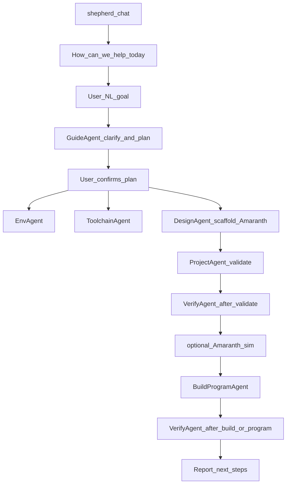
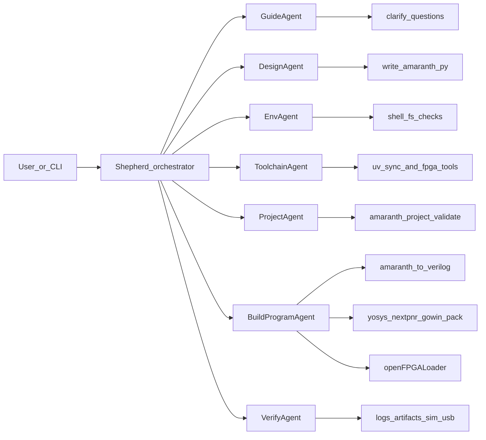

# FPGA Shepherd — Multi-Agent FPGA Programming Toolkit

## Goal

Ship a **hackathon-ready, reusable tool** that helps people **build Tang Nano 9K projects quickly from natural language (NL)** — ordinary human wording, not code or CLI flags.

The user opens Shepherd, we ask something like **“How can we help you today?”**, they say e.g. *“help me read inertial measurement unit (IMU) sensor data on my Tang Nano 9K”*, and Meta Llama–powered agents **clarify → scaffold Amaranth → validate → (optional sim) → build → program**, with an **automatic AI check after each of validate / build / program** to judge whether things look good and what to fix next.

Colleagues and later users can run it, fork it, and add new agents/tools. **v0 board support: Tang Nano 9K only.**

## Product shape

A small **Python CLI package** (`fpga-shepherd` / `shepherd`) that:

- Starts an **interactive guided session** (prompt + clarifying questions), not only one-shot commands
- Talks to **Meta Llama** (`META_API_KEY` + `META_BASE_URL` + model id via env)
- Runs **independent specialist agents** with shared tool interfaces
- Is **Amaranth-first**: DesignAgent scaffolds [Amaranth](https://amaranth-lang.org/docs/amaranth/latest/install.html) Python as the source of truth; Verilog is an **emitted artifact** for the open toolchain
- Builds/programs Tang Nano 9K via CLI (Amaranth convert → OSS CAD Suite / YoWASP Gowin path → `openFPGALoader`) — not the Lushay VS Code UI
- Uses **`uv`** as the standard way to create the environment and install libraries
- Is easy to extend: new agent = new module + tool registrations + prompt

Lushay Code remains an optional human UX note in docs; agents do not drive the extension UI.

## Primary user journey (what we optimize for)



### Auto-check policy (VerifyAgent)

After **every** `validate`, `build`, and `program` step (chat pipeline *and* direct CLI commands), Shepherd **always** runs **VerifyAgent**. It does not replace exit codes; it interprets them plus logs/artifacts and returns a structured verdict:

| After | What VerifyAgent checks | Verdict shape |
| --- | --- | --- |
| **validate** | Amaranth entry module present, project layout, pin/platform mapping, emit/constraints sanity | `pass` / `fail` + fix list; block build on `fail` unless user overrides |
| **build** | Tool exit codes, convert/synth/P&R logs, bitstream `.fs` exists & non-empty, timing/resource warnings | `pass` / `warn` / `fail` + whether to retry or edit Amaranth |
| **program** | openFPGALoader output, USB/device detect clues, success vs cable errors | `pass` / `fail` + next human checks (LEDs, universal asynchronous receiver-transmitter (UART)) when hardware can’t be sensed |

Rules:

- Deterministic facts first (exit code, file exists); Meta Llama explains and prioritizes fixes
- On `fail`, Shepherd stops the happy-path pipeline, shows the verdict, and may loop back to Design/Project/Build with the user’s OK
- On `warn`, continue but surface warnings clearly
- After validate, Shepherd may run a short **Amaranth simulation** when the plan includes testable behavior; VerifyAgent can include sim results
- VerifyAgent is independently runnable: `shepherd check --stage validate|build|program --project …`

Example:

1. Shepherd: *How can we help you today?*
2. User: *Help me read IMU sensor data on my Tang Nano 9K.*
3. GuideAgent asks only what’s needed, e.g.:
   - Which IMU / interface (Inter-Integrated Circuit (I2C)? Serial Peripheral Interface (SPI)? module name if known)?
   - Which pins / PMOD / header?
   - Output preference (LEDs, UART serial, both)?
   - New project path or existing folder?
4. Shepherd proposes a short plan (Amaranth modules, pins, build/program).
5. After user OK: scaffold Amaranth project → validate → **auto-check** → (optional sim) → emit Verilog → build → **auto-check** → program → **auto-check**.
6. Report success / errors and what to try next (e.g. open serial monitor), using VerifyAgent’s last verdict.

Direct commands (`doctor`, `validate`, `build`, `program`) remain available for power users; validate/build/program still trigger auto-check unless `--no-check` is passed.

## Agent map (independent, step-aligned)



| Agent | Role | Responsibility | Acts via |
| --- | --- | --- | --- |
| **Shepherd** | Orchestrator + session host | Ask how we can help; route to specialists; **always invoke VerifyAgent after validate/build/program**; keep structured session context; final report | Agent dispatch + interactive prompts |
| **GuideAgent** | Intent → plan | Parse NL goal; ask clarifying questions; produce a confirmed build plan (interfaces, pins, Amaranth modules, success criteria). **Tang Nano 9K only** — refuse/redirect other boards | Chat + structured plan object |
| **DesignAgent** | Scaffold project (**Amaranth-first**) | From confirmed plan, create/update project: Amaranth Python modules, Tang Nano 9K platform/pin wiring, optional sim stub, README snippet. Raw hand-written Verilog is not the default | File write tools; `lib/board_tangnano9k.py`; Amaranth APIs |
| **EnvAgent** | Step 1 (adapted) | Check Cursor/VS Code + optional Lushay Code; report readiness. Does not block CLI flow if extension missing | `cursor`/`code` extension list/install when available |
| **ToolchainAgent** | Step 2 | Ensure **`uv`** project env + Amaranth deps; detect/verify FPGA CLI tools (`yosys`, nextpnr, `gowin_pack`, `openFPGALoader` via OSS CAD Suite and/or YoWASP) | `uv sync`, suite path config, smoke-test binaries |
| **ProjectAgent** | Step 3 | Validate Amaranth project layout, entrypoint, board id from `boards.yaml`, pin mapping sanity | Filesystem + Amaranth import checks + fix suggestions |
| **BuildProgramAgent** | Step 4 | Convert Amaranth → Verilog → synthesize → P&R → pack → program; capture full logs for VerifyAgent | Amaranth convert/build helpers; `openFPGALoader -b tangnano9k` |
| **VerifyAgent** | Auto-check | After validate/build/program: read exit codes, logs, artifacts, optional sim, USB detect; emit `pass`/`warn`/`fail` + plain-language fixes | Log/artifact/sim tools + Meta Llama judgment |

Each specialist is **independently invokable** (`shepherd run guide`, `shepherd run design`, …) and also used inside `shepherd chat` / `shepherd run`.

## Board constraint (v0)

- **Supported boards are declared in one registry file** (see below). v0 lists **Tang Nano 9K only**.
- GuideAgent / Shepherd load that file as the allowlist — do not hardcode board names in agent prompts alone
- If the user names another board, GuideAgent explains it is unsupported and continues only if they agree to target a listed board
- Per-board pin helpers and `knowledge/*.md` stay optional extras; the registry is the source of truth for “do we support this?”

### Boards registry format

Prefer **YAML** (`boards.yaml`): easy for teammates to read/edit, comments allowed, maps cleanly to structured Python.

Canonical path: [`boards.yaml`](boards.yaml) at the **repo root** (also importable from package data if we package later).

```yaml
# boards.yaml — supported FPGA boards (source of truth for allowlist)
version: 1
default_board: tangnano9k
boards:
  tangnano9k:
    name: Tang Nano 9K
    aliases:
      - tang nano 9k
      - tangnano 9k
      - sipeed tang nano 9k
    supported: true
    vendor: Sipeed
    fpga:
      family: GW1N-9C
      device: GW1NR-LV9QN88PC6/I5
    openfpgaloader:
      board: tangnano9k
    design:
      hdl: amaranth          # source of truth
      emit: verilog          # build artifact
    constraints:
      extension: .cst
    notes: v0 only supported board
```

Rules:

- `boards.<id>.supported: true` is required for Shepherd to accept that board
- `default_board` must reference an existing supported id
- Adding a board later = new YAML entry + optional `knowledge/<id>.md` + `lib/board_*.py` — GuideAgent picks it up from the registry

## Default technical decisions

- **Language**: Python 3.11+
- **Package / env manager**: **`uv`** only for installs and virtualenvs (`uv sync`, `uv add`, `uv run`). Document `uv` in README; do not treat plain `pip install` as the primary path
- **HDL**: **Amaranth-first** (Python HDL). DesignAgent writes Amaranth; build emits Verilog for the open Gowin flow. Hand-edited `.v` is out of band / advanced, not the default scaffold
- **LLM**: Meta Llama via OpenAI-compatible HTTP client. Abstract behind `llm/client.py`
- **Agent loop**: Lightweight ReAct-style loop (model ↔ tools ↔ observation), one loop per agent — no heavy framework lock-in
- **Interaction**: `shepherd chat` is the default happy path (readline / prompt_toolkit style Q&A)
- **Boards**: YAML registry at repo root (`boards.yaml`); Tang Nano 9K only in v0
- **OS**: macOS + Linux for v0; Windows later
- **Secrets**: `.env.example` only; never commit keys

### How teammates start (uv)

```bash
# install uv once: https://docs.astral.sh/uv/
cd FPGA-shepherd
uv sync
cp .env.example .env   # set META_API_KEY yourself
uv run shepherd chat
```

Add dependencies with `uv add <package>` (e.g. Amaranth). Lockfile (`uv.lock`) is committed.

## Session context (handoff object)

Shared across agents:

```text
{
  goal,                 # original user prompt
  answers,              # Q&A from GuideAgent
  plan,                 # confirmed steps + interfaces + pins
  project_path,
  board: "tangnano9k",
  design_hdl: "amaranth",
  oss_cad_path,
  artifacts,            # .py (Amaranth) / emitted .v / .cst / .fs
  last_step,            # validate | build | program | sim
  last_logs,            # captured stdout/stderr from last tool run
  last_verdict,         # VerifyAgent: pass | warn | fail + notes
  errors
}
```

## Proposed repo layout

```text
PLAN.md
README.md
boards.yaml               # supported boards registry (Tang Nano 9K only in v0)
pyproject.toml            # project metadata; managed with uv
uv.lock                   # locked deps (committed)
.env.example
src/shepherd/
  __init__.py
  cli.py
  llm/client.py
  boards.py               # load/validate boards.yaml; allowlist helpers
  agents/
    base.py
    shepherd.py           # orchestrator + chat host
    guide.py              # natural language (NL) goal + clarifying questions
    design.py             # scaffold Amaranth (not raw Verilog-first)
    env.py
    toolchain.py          # uv env + FPGA CLI tool checks
    project.py
    build_program.py      # Amaranth → Verilog → bitstream → program
    verify.py             # auto-check after validate/build/program
  tools/
    shell.py
    oss_cad.py
    project_fs.py
    amaranth_build.py     # convert / sim helpers
    fpga_build.py
    fpga_program.py
    verify_logs.py        # parse/summarize toolchain + loader logs
  lib/
    board_tangnano9k.py   # pin / platform helpers for Amaranth (not agent tools)
  knowledge/
    tangnano9k.md         # board facts for Guide/Design prompts
  config.py
examples/button_led/      # minimal Amaranth fixture + guided-flow demo
docs/extending.md
```

## Core CLI flows

1. `uv run shepherd chat` — **primary**: “How can we help you today?” → guide → Amaranth scaffold → validate → **check** → build → **check** → program → **check**
2. `uv run shepherd doctor` — Env + Toolchain checklist (`uv` + Amaranth + FPGA CLIs)
3. `uv run shepherd validate --project PATH` — then auto VerifyAgent (skip with `--no-check`)
4. `uv run shepherd build --project PATH` — then auto VerifyAgent
5. `uv run shepherd program --project PATH` — build + load (SRAM default; `--flash` optional) → auto VerifyAgent
6. `uv run shepherd check --stage … --project PATH` — VerifyAgent only
7. `uv run shepherd run --goal "..."` — non-interactive pipeline when goal + enough flags are provided

## Build/program command skeleton

Amaranth-first pipeline:

1. Amaranth design sources in the project (`*.py`)
2. Optional: Amaranth simulator smoke test
3. Convert / elaborate to Verilog (Amaranth)
4. `yosys` Gowin synth → nextpnr → `gowin_pack` (OSS CAD Suite and/or YoWASP)
5. `openFPGALoader -b tangnano9k design.fs`

## Extensibility

- Stable **Tool** protocol: name, JSON schema, `run(**kwargs) -> ToolResult`
- Stable **Agent** protocol: `name`, `system_prompt`, `tools`, `run(goal, context) -> AgentResult`
- Later boards = new entry in `boards.yaml` + optional `knowledge/` + `lib/board_*.py`
- Example stub in docs (e.g. `SimAgent` / UART listen)
- New Python deps: always `uv add`, never ad-hoc global pip as the documented path

## Out of scope for v0

- Boards other than Tang Nano 9K
- Verilog-first scaffolding as the default (emitted Verilog only)
- Driving Lushay Code UI / Computer Use
- Windows installer polish
- Fully autonomous hardware bring-up with no user confirmation on pin choices
- Cloud/Lushay cloud builds
- Guaranteeing every sensor datasheet is correct without user confirmation (GuideAgent must ask)

## Implementation order

1. Write / update **`PLAN.md`** (this document)
2. Scaffold Python package with **`uv`** (`pyproject.toml`, `uv.lock`, CLI, Meta LLM client, `.env.example`); `uv add` Amaranth (+ builtin-yosys as needed)
3. Add `boards.yaml` (Tang Nano 9K only, `design.hdl: amaranth`) + `boards.py` loader; implement tools (shell, OSS CAD, Amaranth convert/sim, project FS, build, program, board helpers, verify logs)
4. Implement specialists: Guide, Design (**Amaranth-first**), Env, Toolchain (`uv` + FPGA tools), Project, BuildProgram, **Verify** + Shepherd chat host
5. Example Amaranth project + `README.md` quickstart (`uv sync` / `uv run shepherd chat`; IMU-style guided example)
6. Smoke-test: `chat` / `doctor` → `validate`+check → `build`+check; `program`+check when board connected

## Success criteria

- User can `uv sync` then `uv run shepherd chat`, state a Tang Nano 9K goal in plain language, answer a few questions, and get a scaffolded **Amaranth** project that builds
- After validate/build/program, user always gets an AI verdict (`pass`/`warn`/`fail`) with concrete next steps — not just raw toolchain spam
- Teammate can clone, set Meta API key, run `uv run shepherd doctor` and understand what’s missing
- Each agent runnable alone; full pipeline programs Tang Nano 9K when hardware + tools present
- Clear extension path for adding agents without rewriting the core loop
- Meta model usage is explicit and central; **`uv`** is the documented install path

## Human toolchain reference (agents use CLI equivalents)

1. Optional editor extension (Lushay Code) for humans
2. `uv` project env + Amaranth ([install guide](https://amaranth-lang.org/docs/amaranth/latest/install.html))
3. FPGA open toolchain (OSS CAD Suite and/or YoWASP) + `openFPGALoader`
4. Project: Amaranth sources → emit Verilog → build → program Tang Nano 9K
