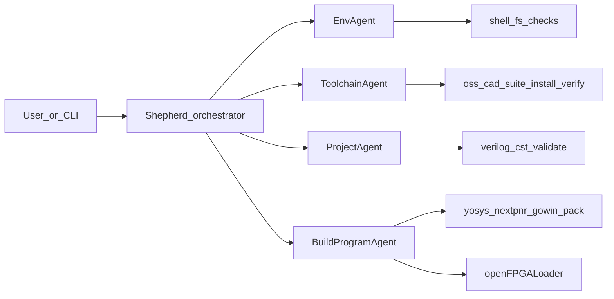

# FPGA Shepherd — Multi-Agent FPGA Programming Toolkit

## Goal

Ship a **hackathon-ready, reusable tool** in this repo that lets Meta Llama–powered agents **reason and act** (via CLI) through the steps to set up, build, and program a Tang Nano 9K FPGA design. Colleagues and later users can run it, fork it, and add new agents/tools.

## Product shape

A small **Python CLI package** (`fpga-shepherd` / `shepherd`) that:

- Talks to **Meta Llama** (OpenAI-compatible Meta Llama API as default; `META_API_KEY` + `META_BASE_URL` + model id via env)
- Runs **independent specialist agents** with shared tool interfaces
- Executes real FPGA work through **OSS CAD Suite CLI** (not the Lushay VS Code UI)
- Is easy to extend: new agent = new module + tool registrations + prompt

Lushay Code remains an optional human UX note in docs; agents do not drive the extension UI.

## Agent map (independent, step-aligned)



| Agent | Maps to human step | Responsibility | Acts via |
| --- | --- | --- | --- |
| **EnvAgent** | Step 1 (adapted) | Check Cursor/VS Code + optional Lushay Code install; report PATH/editor readiness. Does not block CLI flow if extension missing. | `cursor`/`code --list-extensions`, `--install-extension lushay-code…` when available |
| **ToolchainAgent** | Step 2 | Detect/install/verify OSS CAD Suite; ensure `yosys`, `nextpnr-*`, `gowin_pack`, `openFPGALoader` on PATH (or suite `environment` sourced). macOS + Linux. | Download/extract suite, write config path, smoke-test binaries |
| **ProjectAgent** | Step 3 | Open/validate project folder: ≥1 `.v`, ≥1 `.cst`, top module convention (`top` by default), pin file sanity. | Filesystem read, simple parse/heuristics, clear fix suggestions |
| **BuildProgramAgent** | Step 4 | Synthesize → P&R → pack → program Tang Nano 9K; diagnose log failures and retry with reasoned fixes when safe. | `yosys`, `nextpnr-himbaechel`/`nextpnr-gowin`, `gowin_pack`, `openFPGALoader -b tangnano9k` |
| **Shepherd** | Orchestrator | Decide which specialist to call; pass structured handoff (paths, board, last errors); stop with a human-readable report. | Agent-to-agent dispatch only |

Each specialist is **independently invokable** (`shepherd run toolchain`, `shepherd run build --project …`) and also runnable as a full pipeline (`shepherd program --project …`).

## Default technical decisions

- **Language**: Python 3.11+
- **LLM**: Meta Llama via OpenAI-compatible HTTP client (official Meta Llama API if key available; otherwise any Meta-compatible endpoint). Abstract behind `llm/client.py` so hackathon judges see clear Meta usage and others can swap providers.
- **Agent loop**: Lightweight ReAct-style loop (model ↔ tools ↔ observation), one loop per agent — no heavy framework lock-in so teammates can build on top. Optional later: Llama Stack if the team already has a stack URL.
- **Board default**: Tang Nano 9K (`GW1NR-LV9QN88PC6/I5`, `openFPGALoader -b tangnano9k`)
- **OS**: macOS (this machine) + Linux documented; Windows later/out of scope for v0
- **Secrets**: `.env.example` only; never commit keys (user sets `META_API_KEY` themselves)

## Proposed repo layout

```text
PLAN.md
README.md                 # quickstart for hackathon users
pyproject.toml
.env.example
src/shepherd/
  __init__.py
  cli.py                  # Typer/argparse entry
  llm/client.py           # Meta Llama client
  agents/
    base.py               # shared ReAct loop + tool schema
    env.py
    toolchain.py
    project.py
    build_program.py
    shepherd.py           # orchestrator
  tools/
    shell.py
    oss_cad.py
    project_fs.py
    fpga_build.py
    fpga_program.py
  config.py               # board paths, suite path, model id
examples/button_led/      # minimal Verilog + .cst fixture
docs/extending.md         # how to add an agent/tool
```

## Core CLI flows (demo for judges / teammates)

1. `shepherd doctor` — Env + Toolchain checks, print green/red checklist
2. `shepherd validate --project PATH` — ProjectAgent only
3. `shepherd build --project PATH` — build bitstream only
4. `shepherd program --project PATH` — build + `openFPGALoader` (SRAM default; `--flash` optional)
5. `shepherd run` — full Shepherd pipeline with natural-language goal string

## Build/program command skeleton (agent tools wrap these)

Aligned with OSS CAD Suite / Apicula Tang Nano 9K flow:

1. `yosys -p "read_verilog …; synth_gowin -top top -json out.json"`
2. `nextpnr-himbaechel` (or suite’s Gowin nextpnr) with device + `.cst`
3. `gowin_pack -d GW1N-9C -o design.fs …`
4. `openFPGALoader -b tangnano9k design.fs`

Agents must capture stderr, classify errors (missing top, bad pin, USB not found), and return structured results to Shepherd.

## Extensibility (hackathon “build on top”)

- Stable **Tool** protocol: name, JSON schema, `run(**kwargs) -> ToolResult`
- Stable **Agent** protocol: `name`, `system_prompt`, `tools`, `run(goal, context) -> AgentResult`
- Documented handoff `context` dict: `{project_path, board, oss_cad_path, artifacts, errors}`
- Example stub agent in docs (e.g. `SimAgent` / UART listen) so others can copy-paste

## Out of scope for v0

- Driving Lushay Code UI / Computer Use
- Windows installer polish
- Full Verilog authoring / RTL generation agent (can be a follow-on specialist)
- Cloud/Lushay cloud builds

## Implementation order

1. Write **`PLAN.md`** (this document) — shareable team copy
2. Scaffold Python package + CLI + Meta LLM client + `.env.example`
3. Implement tools (shell, OSS CAD detect/install verify, project validate, build, program)
4. Implement four specialists + Shepherd orchestrator
5. Add minimal example project; update `README.md` with hackathon quickstart
6. Smoke-test: `doctor` → `validate` → `build` on a sample design; `program` when board is connected

## Success criteria

- Teammate can clone, set Meta API key, run `shepherd doctor` and understand what’s missing
- Each agent runnable alone; full pipeline programs Tang Nano 9K when hardware + suite present
- Clear extension path documented for adding a fifth agent without rewriting the core loop
- Meta model usage is explicit and central (not Cursor’s built-in model)

## Human workflow this maps to (reference)

Original Tang Nano 9K / Lushay flow (agents use CLI equivalents):

1. Install VS Code / Cursor extensions (optional Lushay Code for humans)
2. Install OSS CAD Suite toolchain
3. Open project with Verilog sources + `.cst` constraints
4. Build and program (yosys → nextpnr → gowin_pack → openFPGALoader)
