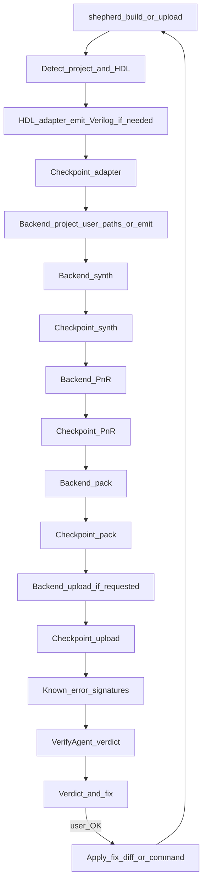

# FPGA Shepherd — AI-assisted FPGA devkit

## Acronyms

Defined once here; used abbreviated afterward in this document.

| Acronym  | Meaning                                                                          |
| -------- | -------------------------------------------------------------------------------- |
| **AI**   | artificial intelligence                                                          |
| **API**  | application programming interface                                                |
| **CI**   | continuous integration                                                           |
| **CLI**  | command-line interface                                                           |
| **CST**  | constraint file (Gowin `.cst` pin constraints)                                   |
|          |                                                                                  |
| **EDA**  | electronic design automation                                                     |
| **FPGA** | field-programmable gate array                                                    |
| **HDL**  | hardware description language                                                    |
|          |                                                                                  |
| **I/O**  | input/output                                                                     |
|          |                                                                                  |
| **OS**   | operating system                                                                 |
| **P&R**  | place and route                                                                  |
| **RTL**  | register-transfer level                                                          |
| **SRAM** | static random-access memory                                                      |
| **SV**   | SystemVerilog                                                                    |
| **UART** | universal asynchronous receiver-transmitter                                      |
|          |                                                                                  |
| **USB**  | Universal Serial Bus                                                             |
| **UX**   | user experience                                                                  |
| **VHDL** | VHSIC Hardware Description Language (VHSIC = very high speed integrated circuit) |
| **YAML** | YAML Ain’t Markup Language (human-readable data format)                          |


## Goal

Ship a **hackathon-ready tool** that speeds up adoption of complex chips like **field-programmable gate arrays (FPGAs)**, with the intention of simplifying the process of **physical AI** — getting real hardware into the loop without drowning in toolchain pain.

**Shepherd is the interface.** Users learn Shepherd’s commands, Shepherd’s project file and Shepherd’s output — nothing else. Under the hood, Shepherd drives **[apio](https://fpgawars.github.io/apio/docs)** as its build backend (toolchain install, board definitions, synthesis / **place and route (P&R)** / pack / program). apio is an implementation detail: users never need to know it exists, install it, run it, or edit its files.

What Shepherd gives the user:

1. **Zero-friction bootstrap** — one small **install script** puts Shepherd on PATH (`uv` + `uv tool install` under the hood); then **`shepherd init`** sets up the project **and** installs dependencies via **`uv` internally** (plus apio packages) — users never run `pip` or hand-roll package installs
2. **Right hardware description language (HDL) adapter for your design** — Verilog/SystemVerilog (**SV**) build directly; Amaranth (and later **VHDL**, SpinalHDL, Chisel) are elaborated to Verilog first
3. **Failure diagnosis** — Yosys / nextpnr / openFPGALoader output turned into a cause + concrete fix (Meta Llama, after deterministic matchers)
4. **Environment fixing** — toolchain, drivers, udev, **Universal Serial Bus (USB)** detection; `init` first, `doctor --fix` to repair
5. **Project adoption** — point Shepherd at an existing repo; it detects HDL, top module, sources and constraints and writes `shepherd.toml`

**Audience:** people putting FPGAs (and similar chips) to work for physical AI and embedded systems — including digital-design engineers. You bring the design; Shepherd simplifies build, flash, and diagnosis.
**v0 board support: Tang Nano 9K only.** Board/part/programmer facts come from the backend (apio) — Shepherd does not ship board or pin **YAML** registries.

## Pitch

> Shepherd speeds up FPGA adoption so physical AI is easier to build on real hardware — you bring the design; `shepherd init` sets up deps; we simplify build, board bring-up, and fixing failures.

## User journey and stack

Same schematic as [`README.md`](README.md).

<table>
  <tr>
    <td width="9%" align="right" valign="middle"><em>Stage</em></td>
    <td width="12%" align="center"><b>System setup</b></td>
    <td width="2%" align="center"><b>→</b></td>
    <td width="12%" align="center"><b>Define project</b></td>
    <td width="2%" align="center"><b>→</b></td>
    <td width="12%" align="center"><b>Adapt HDL</b></td>
    <td width="2%" align="center"><b>→</b></td>
    <td width="12%" align="center"><b>Synth / P&amp;R / pack</b></td>
    <td width="2%" align="center"><b>→</b></td>
    <td width="12%" align="center"><b>Program board</b></td>
    <td width="2%" align="center"><b>→</b></td>
    <td width="12%" align="center"><b>Debug / diagnose</b></td>
    <td width="2%" align="center"><b>→</b></td>
    <td width="12%" align="center"><b>Live view</b><br/><em>(optional)</em></td>
  </tr>
  <tr>
    <td width="9%" align="right" valign="top"><em>Commands</em></td>
    <td width="12%" align="center" valign="top"><code>install.sh</code></td>
    <td width="2%"></td>
    <td width="12%" align="center" valign="top"><code>shepherd init</code></td>
    <td width="2%"></td>
    <td width="12%" align="center" valign="top"><code>shepherd build</code><br/><em>(adapter step)</em></td>
    <td width="2%"></td>
    <td width="12%" align="center" valign="top"><code>shepherd build</code></td>
    <td width="2%"></td>
    <td width="12%" align="center" valign="top"><code>shepherd upload</code></td>
    <td width="2%"></td>
    <td width="12%" align="center" valign="top"><code>shepherd explain</code><br/><code>shepherd ask</code></td>
    <td width="2%"></td>
    <td width="12%" align="center" valign="top"><code>shepherd ui</code></td>
  </tr>
  <tr>
    <td width="9%" align="right" valign="top"><em>Under the hood</em></td>
    <td width="12%" align="center" valign="top">uv + shepherd<br/>init → uv · apio pkgs</td>
    <td width="2%"></td>
    <td width="12%" align="center" valign="top"><code>shepherd.toml</code><br/>AdoptAgent</td>
    <td width="2%"></td>
    <td width="12%" align="center" valign="top">Verilog/SV passthrough<br/>Amaranth emit</td>
    <td width="2%"></td>
    <td width="12%" align="center" valign="top">apio · Yosys · nextpnr<br/>checkpoints</td>
    <td width="2%"></td>
    <td width="12%" align="center" valign="top">openFPGALoader<br/>Tang Nano 9K</td>
    <td width="2%"></td>
    <td width="12%" align="center" valign="top">VerifyAgent · signatures<br/>Meta Llama</td>
    <td width="2%"></td>
    <td width="12%" align="center" valign="top">Next.js · SQLite events<br/>watch / click-run</td>
  </tr>
</table>

**Retry:** Debug **⇢** Adapt (fix and retry)

**Optional:** `shepherd ui` opens the live view anytime after the project exists (not only after debug). Same SQLite events as the CLI.

- Build path is deterministic; **Meta Llama** is for diagnosis / `explain` / `ask`, not for picking synth flags
- CLI first; UI observes the same journey via SQLite events

## Design principles

- **Interface-first.** Shepherd’s **command-line interface (CLI)**, `shepherd.toml` and output are the product. No backend command, file or term appears in the normal flow — not in help text, prompts, errors, fixes or docs’ quickstart
- **apio is an under-the-hood module.** All backend calls go through one `backend/` package behind a stable `Backend` protocol. Nothing outside `backend/apio/` knows apio exists, so the backend can be pinned, upgraded or swapped (e.g. a vendor-flow backend later) without changing the interface
- **The backend does the toolchain and board work.** Shepherd never re-implements synthesis, P&R, packing, programming, or board/pin databases. Bugs or missing boards in apio go upstream, not into Shepherd
- **Drive the apio CLI, don’t import its internals.** apio is called as a subprocess; its Python internals are not a stable **application programming interface (API)**. Version pinned and checked by `doctor`
- **Translate, don’t leak.** apio’s own messages and hints (e.g. “run `apio drivers …`”) are rewritten into Shepherd terms (“run `shepherd doctor --fix`”). Raw *toolchain* logs (Yosys, nextpnr, openFPGALoader) stay available because experienced users want them — those are the tools, not the backend
- **Transparent on request (first-class).** `-v` streams raw toolchain output; **`--show-backend`** / `--dry-run` print the exact underlying commands (also an Advanced toggle in the UI). Default output is Shepherd’s steps + verdict
- **Deterministic first, artificial intelligence (AI) second.** HDL-adapter choice, flags and known error signatures are plain code. Meta Llama explains, prioritizes and handles the long tail — it never silently picks flags
- **Checkpoint checkers after every stage.** Adapter → synth → P&R → pack → upload → verify each have a loud fail-fast check (including SystemVerilog subset smoke checks)
- **Never mutate the user’s project without consent.** AI-proposed edits (`.cst` constraint files, `shepherd.toml`, source) are shown as diffs and applied only on confirmation; UI spawns use `--yes` / non-interactive mode so prompts never hang a subprocess
- **Works offline where possible.** `--no-ai` skips explanations; when the network is required (first toolchain install, LLM call), Shepherd prints a **clear, simple error** naming what needs internet — never a raw stack trace
- **CLI first.** Ship `doctor` / `init` / `build` / `upload` + SQLite events + checkers before the Next.js UI ([`PLAN_UI.md`](PLAN_UI.md))
- **`uv` only — never `pip` / `pipx`.** End users install Shepherd via a **small install script** (installs `uv` if missing, then `uv tool install fpga-shepherd`). They do not run `uv sync` / `uv add` by hand. After that, **`shepherd init` bootstraps everything** (calling `uv` under the hood where needed, plus apio packages/drivers). Contributors use `uv` in this repo as usual

## Product shape

A small **Python CLI package** (`fpga-shepherd`, command `shepherd`):

- Shepherd’s own command set (`build`, `upload`, `lint`, `sim`, `test`, `report`, `doctor`, `init`, `explain`, `ask`); each command = HDL adapter → backend step → verify + diagnose
- Talks to **Meta Llama** (`META_API_KEY` + `META_BASE_URL` + model id via env), OpenAI-compatible client over **Hypertext Transfer Protocol (HTTP)**
- Uses `**uv**` for its own env; **apio is a pinned dependency** of the package (`uv add apio`), installed automatically with Shepherd — the user never installs it separately
- Machine-readable output (`--json`) for **continuous integration (CI)** and editor integrations
- Extensible: new HDL adapter / error signature / agent / backend = new module + registration
- Optional web UI is specified in [`PLAN_UI.md`](PLAN_UI.md). **Demo integration is a shared SQLite events DB** — Shepherd writes events; the UI reads them. **No FastAPI** (or other HTTP job API) between them

## Primary flow



Example (experienced user, existing SystemVerilog repo; default output):

```text
$ shepherd build
→ project: SystemVerilog, top=blinky, board=tangnano9k
→ synth   ok
→ pnr     FAIL
→ verdict: FAIL  (signature: nextpnr-unconstrained-io)
   cause: port `uart_tx` has no IO_LOC in tangnano9k.cst
   fix:   add `IO_LOC "uart_tx" 17;` (on-board USB–UART TX) — apply? [y/N]
   log:   .shepherd/runs/2026-10-30T14-02-11/pnr.log   (or re-run with -v)
```

Pin / constraint / board mistakes are surfaced by the toolchain (nextpnr / openFPGALoader) and interpreted by VerifyAgent. Shepherd does **not** drive builds from a local pin database; diagnosis may use curated pin-facts + datasheet links (see Knowledge) so fix suggestions stay grounded.

## Backend layer (apio, hidden)

```text
shepherd CLI ─┬─ HDL adapters ──► staging dir (.shepherd/build/)
              └─ Backend protocol ──► backend/apio/  ──► apio CLI ──► yosys / nextpnr / gowin_pack / openFPGALoader
```

`Backend` protocol (the only thing the rest of Shepherd sees):

| Method | apio implementation |
| --- | --- |
| `ensure_toolchain()` | `apio packages list/install` |
| `boards()` / `resolve_board(name)` | `apio boards` (friendly name ↔ apio board id) |
| `write_project(stage_dir, board, top, sources)` | `apio create` / generated `apio.ini` |
| `build()` / `upload(flash=…)` | `apio build` / `apio upload` |
| `lint()` / `sim()` / `test()` / `report()` | matching apio commands |
| `devices()` / `install_drivers(kind)` | `apio devices` / `apio drivers install` |
| `version()` | `apio --version` |

Rules:

- **`apio.ini` is generated, never user-owned.** It is written into `.shepherd/build/` from `shepherd.toml` on every run; users don’t see or edit it
- **Board names are Shepherd’s.** Users write `board = "tangnano9k"`; a **tiny allowlist** in the backend maps that to apio id `sipeed-tang-nano-9k` and validates via `apio boards`. This is not a Shepherd board registry — just a friendly-name map. v0 accepts only Tang Nano 9K
- **Output translation lives in `backend/apio/translate.py`.** apio-specific hints, command names and paths are mapped to Shepherd equivalents before anything reaches the user or the LLM prompt
- **Source order is explicit.** Prefer an ordered `sources = [...]` list in `shepherd.toml`. If globs are used, expand and sort deterministically before handing to the backend (do not rely on opaque lexicographic surprises)
- apio facts the backend must respect (apio 1.6 CLI): `*_tb.v` / `*_tb.sv` are ignored for build, top module comes from `top-module`, `upload` builds implicitly
- **Escape hatch (first-class for power users):** `--show-backend` and `shepherd backend -- <args>` for debugging Shepherd itself

## Staging and path fidelity

- **Pure Verilog / SV:** prefer generating a backend project that references **user source paths** (absolute or project-relative). Avoid copying the whole tree into staging when unnecessary
- **Amaranth (and other emitters):** emit `.v` into `.shepherd/build/`; keep `.cst` / user constraints as the user’s files or symlinks into staging
- **User-facing errors:** rewrite any staging paths back to the original project paths before printing or writing events
- **Checkpoint after adapter:** emitted Verilog exists, top module present, before synth starts

## Checkpoint checkers

After **every** pipeline stage, run a deterministic checker before continuing. On failure: stop, write a `fail` event, point at the step log.

| After | Checker (examples) |
| --- | --- |
| **HDL adapter** | Exit 0; emitted/passthrough Verilog present; top module resolvable; for `.sv`, smoke-elaborate / subset gate with a **clear** message if Yosys will reject constructs |
| **synth** | Exit 0; expected synth artifacts present |
| **P&R** | Exit 0; P&R output present |
| **pack** | Exit 0; bitstream `.fs` exists and is non-empty |
| **upload** | Exit 0; device seen / programmer success phrases |
| **verify** | Verdict written; findings structured |

`shepherd check --stage …` re-runs the checker + VerifyAgent on the last run’s logs.

## Auto-check policy (VerifyAgent)

After **every** `build`, `upload`, `lint`, `test` (and on demand via `shepherd check`), Shepherd runs VerifyAgent unless `--no-check`.

| After | Deterministic facts | AI adds |
| --- | --- | --- |
| **HDL adapter** | emitter exit code, Verilog produced, top module present | why elaboration failed, in source terms |
| **build** | backend exit code, bitstream exists & non-empty, utilization/timing from `report` | cause + fix for synth/P&R failures; auto re-run with verbose synth/P&R when output is too thin |
| **upload** | openFPGALoader output, device scan, **static random-access memory (SRAM)** vs flash | driver / udev / cable / board-mode fixes, phrased as `shepherd doctor --fix` steps |
| **lint / test** | Verilator / testbench exit codes | grouped, deduplicated findings |

Rules:

- Verdict is `pass` / `warn` / `fail` + fix list; `fail` stops the pipeline
- Known error signatures (`knowledge/errors/*.yaml`, regex + explanation + fix) are matched **before** calling the **large language model (LLM)**; an LLM-diagnosed error that recurs is a candidate for a new signature
- Fix suggestions are always Shepherd commands or project edits — never backend commands
- The LLM gets: the step run, trimmed (translated) logs, `shepherd.toml`, `.cst`, and relevant source snippets — never the whole repo by default
- `shepherd explain [LOGFILE]` diagnoses the last run or any pasted log

## Agents (small, step-aligned)

Fewer agents than a chat-app design: most of the pipeline is deterministic tools; agents exist where judgment helps.

| Agent | Responsibility | Acts via |
| --- | --- | --- |
| **Shepherd** (orchestrator) | Run the pipeline for a command; always invoke VerifyAgent after steps; write the run record | Tool dispatch, no chat by default |
| **DoctorAgent** | Check Python/uv, toolchain, drivers, udev, connected devices; propose exact fix commands | `Backend.ensure_toolchain/devices/install_drivers` + shell checks |
| **AdoptAgent** | Adopt an existing repo: detect HDL(s), candidate top modules, sources/testbenches, `.cst`; propose `shepherd.toml` (imports an existing `apio.ini` if one is found) | Filesystem scan + `Backend.resolve_board` |
| **VerifyAgent** | Verdict after each step: deterministic facts + signature match + Meta Llama diagnosis | Log parsers, `Backend.report`, signature **database (DB)** |

`shepherd ask "..."` is an optional Q&A mode with the project and last run as context (e.g. “why is fmax 27 MHz?”). It is a helper, not the main entry point.

## HDL adapters

An **HDL adapter** converts the user’s design language into something the backend can build (almost always Verilog). The open flow speaks Verilog/SV; other languages need a conversion step first. This is not a **user interface (UI)**.

| HDL | v0 path | Status |
| --- | --- | --- |
| Verilog (`.v`) | passthrough adapter | v0 |
| SystemVerilog (`.sv`) | passthrough adapter (Yosys SV support) | v0 — **checkpoint** fails early with a clear Shepherd message if constructs are outside the supported subset |
| Amaranth (`.py`) | Amaranth elaborate → Verilog into `.shepherd/build/` | v0 |
| VHDL | GHDL synth → Verilog (or ghdl-yosys-plugin) | stretch — verify GHDL availability alongside the backend toolchain |
| SpinalHDL / Chisel | run user’s generator → Verilog | later |

Mixed-language projects: each non-Verilog source is emitted to Verilog, then everything is built as one project. User-visible tree stays sources + `shepherd.toml` (+ `.cst`); generated backend files live under `.shepherd/`.

## Boards

- **No** `boards.yaml` build registry; **no** pin DB driving apio
- Project board lives in **`shepherd.toml`** (`board = "tangnano9k"`). Tiny backend allowlist → apio id; validate with `apio boards`
- Pin / part / programmer knowledge for *build* comes from the backend + toolchain errors
- Adding another board later = backend supports it + lift allowlist entry

### Knowledge: datasheets + diagnosis pin-facts

`knowledge/` is for **human/LLM / Verify diagnosis**, not for replacing apio.

1. **Datasheets (keep):** URLs + roles so `ask` / `explain` cite the right docs  
2. **Pin-facts + fix templates (keep small):** `knowledge/tangnano9k.pins.md` (LED / UART / button nets from schematic) and `knowledge/errors/*.yaml` fix templates — used **only** by Verify/Explain so suggestions are grounded. **Not** used as a build-time board registry  

```yaml
# example structured block in knowledge/tangnano9k.datasheets.yaml
board: tangnano9k
datasheets:
  - id: gowin-gw1nr-9
    title: GW1NR-9 / GW1NR series FPGA datasheet
    role: fpga_device          # fpga_device | board | peripheral | programming
    url: https://...
    notes: Use for pin banks, IO standards, timing
  - id: sipeed-tang-nano-9k-schematic
    title: Tang Nano 9K schematic / board doc
    role: board
    url: https://...
    notes: On-board LED / UART / button net names
```

Rules:

- Prefer **vendor URLs + document title/version** over pasting datasheet text into the repo
- Agents resolve datasheets by `board` + `role`; pin-facts for concrete `IO_LOC` suggestions
- Do not invent electrical facts from memory when a datasheet or pin-facts entry exists

## Project config

- **`shepherd.toml`** is the only project file users write: board, top module, sources, HDL adapters, constraints, AI on/off
- The backend project file (`apio.ini`) is generated under `.shepherd/build/` and is not user-facing

```toml
board = "tangnano9k"
top = "blinky"
sources = ["rtl/blinky.sv", "rtl/uart.sv"]   # prefer explicit order
constraints = "tangnano9k.cst"

[adapters]
amaranth = { entry = "rtl/top.py:Top" }

[checks]
ai = true
```

## Run state (no `run.json`)

**Canonical store = SQLite events DB** + **per-step log files**. We do **not** write `run.json` (avoids dual sources of truth). Revisit only if SQLite append volume proves too slow in practice (unlikely at demo log rates).

Layout:

```text
.shepherd/
  shepherd.db                 # runs + events (canonical)
  runs/<run_id>/
    pid                       # process id / group for UI cancel
    adapter.log
    synth.log
    pnr.log
    …
```

`shepherd explain` / `ask` read the latest run from SQLite + those logs.

### Shared events DB (CLI + UI)

Path: `.shepherd/shepherd.db` (schema in [`PLAN_UI.md`](PLAN_UI.md)).

```text
shepherd CLI ──write──► SQLite events DB ◄──read── Next.js UI
                 ▲
                 └── same machine, no FastAPI in between
```

Rules:

- Python owns writes (migrations + append). The UI only reads (and may spawn `uv run shepherd …`)
- **Do not** add a FastAPI/Express bridge for the demo
- UI cancel: see [`PLAN_UI.md`](PLAN_UI.md) (run id + **PID** / process group)

### Network-required errors

When a step needs internet (e.g. first `apio packages install`, Meta Llama call) and the network fails or is offline, Shepherd prints a short message such as:

```text
error: internet required for <toolchain install | AI explanation>
  what failed: <one line>
  what to do: connect to the network and re-run `shepherd init`
              (or `shepherd doctor --fix` to repair)
              or re-run without AI: `shepherd build --no-ai`
```

No traceback as the primary UX.

## CLI

| Command | Does |
| --- | --- |
| `shepherd --help` / `-h` / `shepherd help` | **Built-in help:** top-level usage, subcommands, global flags (Shepherd terms only — no apio leak). `shepherd <cmd> --help` for per-command help |
| `shepherd doctor [--fix]` | Env + toolchain + drivers + devices checklist; `--fix` proposes/runs fixes with confirmation (repair path) |
| `shepherd init [PATH]` | **Primary setup:** write/adopt `shepherd.toml`, then **install/verify deps via `uv` (internal) + apio packages**, driver guidance — no `pip`, no manual `uv sync` |
| `shepherd build` | HDL adapter → build → verify |
| `shepherd upload [--flash]` | HDL adapter → build + program (SRAM by default) → verify |
| `shepherd lint` / `sim` / `test` / `report` | HDL adapter → matching step → verify where useful |
| `shepherd check --stage …` | VerifyAgent on the last run |
| `shepherd explain [LOG]` | Diagnose last failure or any log |
| `shepherd ask "…"` | Optional Q&A with project + last run as context |
| `shepherd ui` | **Optional:** open the live Next.js view for this project (SQLite events; spawn CLI with `--yes`). See [`PLAN_UI.md`](PLAN_UI.md) |

Global flags: `--no-ai`, `--no-check`, `--yes` (non-interactive; required for UI spawns), `--json`, `--dry-run`, `--show-backend`, `-v`, **`--help` / `-h`**.

Advanced: `shepherd backend -- <args>` (see Backend layer).

Help is part of the **CLI-first** milestone: every subcommand ships with usable `--help` before UI work starts.

## Default technical decisions

- **Language**: Python 3.11+
- **Package manager:** **`uv` only** — never document or call `pip` / `pipx`
- **Contributors:** `uv sync` / `uv.lock` in this repo
- **End users:** one **install script** (e.g. `curl -LsSf …/install.sh | sh`) that: (1) installs **`uv`** if needed, (2) runs **`uv tool install fpga-shepherd`**. After that they only run `shepherd …`. **`shepherd init`** / `doctor --fix` invoke **`uv` internally** for envs/deps and pull apio toolchain packages
- **Backend**: apio (pinned, `>=1.6,<2`) behind `backend/`; packages pulled during `init` / `doctor --fix`
- **Install script:** [`scripts/install.sh`](scripts/install.sh) (curl one-liner in README). Installs `uv` if needed, then `uv tool install` from this GitHub repo until `fpga-shepherd` is on PyPI
- **LLM**: Meta Llama via OpenAI-compatible HTTP client behind `llm/client.py`
- **Agent loop**: lightweight ReAct-style loop per agent; no heavy framework
- **Run state**: SQLite + step logs; **no `run.json`**
- **Operating system (OS)**: macOS + Linux for v0; Windows later
- **Secrets**: `.env.example` only; never commit keys
- **Credit**: README acknowledges apio as the build backend and we respect its license — hidden from the default workflow, not from credits; `--show-backend` for power users
- **UI (optional, after CLI):** Next.js in `web/` per [`PLAN_UI.md`](PLAN_UI.md); shared SQLite events; **no FastAPI**

### How end users start

```bash
# once: install script → uv (if needed) + uv tool install fpga-shepherd
curl -LsSf https://raw.githubusercontent.com/FrankP89/FPGA-shepherd/main/scripts/install.sh | sh

cd my-fpga-project                  # or an empty folder
shepherd init                       # uv + apio deps installed internally
# optional: export META_API_KEY=... for explain/ask
shepherd build
shepherd upload
```

### How contributors start (this repo)

```bash
cd FPGA-shepherd
uv sync
cp .env.example .env
uv run shepherd init examples/blinky_sv
uv run shepherd upload --project examples/blinky_sv
```

## Proposed repo layout

```text
PLAN.md
PLAN_UI.md                  # Next.js UI + shared SQLite events (no FastAPI)
README.md
scripts/
  install.sh                # end-user: install uv if needed + uv tool install fpga-shepherd
pyproject.toml              # uv-managed; depends on apio (backend)
uv.lock
.env.example
web/                        # optional Next.js UI (see PLAN_UI.md)
src/shepherd/
  __init__.py
  cli.py
  config.py                 # shepherd.toml read/write
  events/
    db.py                   # SQLite canonical run/event store
    schema.sql
    logs.py                 # .shepherd/runs/<run_id>/*.log + pid file
  llm/client.py
  backend/
    base.py                 # Backend protocol (only interface the rest of Shepherd uses)
    apio/
      runner.py             # subprocess wrapper, version check, log capture
      project.py            # generate apio.ini; board allowlist map; user-path sources
      parse.py              # apio / yosys / nextpnr / openFPGALoader output parsing
      translate.py          # rewrite apio hints/commands into Shepherd terms
  adapters/                 # HDL adapters (not a UI)
    base.py                 # protocol: detect(), emit() -> Verilog
    verilog.py              # passthrough (.v / .sv)
    amaranth.py
    vhdl.py                 # stretch
  checks/
    checkpoints.py          # fail-fast checkers after each stage
    artifacts.py            # bitstream / log artifact presence checks
    paths.py                # rewrite staging paths → user paths
  agents/
    base.py
    shepherd.py             # orchestrator
    doctor.py
    adopt.py
    verify.py
  knowledge/
    tangnano9k.md           # board context for LLM
    tangnano9k.datasheets.yaml
    tangnano9k.pins.md      # diagnosis-only pin/net facts (not a build registry)
    errors/                 # known error signatures (regex → cause → fix)
      yosys.yaml
      nextpnr.yaml
      openfpgaloader.yaml
      backend.yaml
examples/
  blinky_sv/                # plain SystemVerilog (SV) + shepherd.toml
  uart_amaranth/            # Amaranth HDL adapter (UART demo)
  broken/                   # intentionally broken projects for demo + tests
docs/extending.md           # new HDL adapter / signature / agent / backend
```

## Extensibility

- **HDL adapter** protocol: `detect(project) -> bool`, `emit(project, out_dir) -> list[Path]`
- **Backend** protocol: see Backend layer; apio is the only v0 implementation
- **Error signature**: YAML entry (tool, regex, cause, fix template in Shepherd terms) — no code
- **Agent** protocol: `name`, `system_prompt`, `tools`, `run(context) -> AgentResult`
- **Board**: whatever the backend supports, enabled via Shepherd’s allowlist

## Out of scope for v0

- Re-implementing anything the backend does (toolchain install, synth/P&R, programming, board/pin databases)
- Exposing apio to users (commands, `apio.ini`, terminology) in the normal workflow
- Shepherd-owned **build-time** pin/board registry (diagnosis-only pin-facts + datasheets are in scope)
- Natural-language → full design scaffolding (out of scope for v0; focus is simplifying FPGA bring-up for physical AI, not inventing RTL from a prompt)
- Boards other than Tang Nano 9K
- Additional backends (e.g. Gowin vendor **electronic design automation (EDA)**) — the protocol allows it later
- Windows polish
- Auto-applying AI fixes without confirmation
- Claiming functional correctness — Shepherd checks build/program health; behavior is the user’s testbench’s job (`shepherd test` runs it)
- **FastAPI** (or any HTTP job API) between Shepherd and the UI for the demo — use the shared SQLite events DB instead (see [`PLAN_UI.md`](PLAN_UI.md))

## Hackathon demo script

1. Fresh machine: install script (`uv` + `uv tool install`) → `shepherd init` (uses `uv` internally + apio packages; internet may be required; clear error if offline)
2. Existing SV repo: `shepherd init` → detected top + board → `shepherd.toml` → deps ready → builds
3. `examples/broken/` with a bad constraint / unconstrained port → P&R fails → `shepherd explain` proposes a fix diff
4. Amaranth project → `shepherd upload` → emitted Verilog → board blinks / UART prints
5. A nextpnr failure with an unknown signature → `shepherd explain` → Meta Llama (**LLM**) diagnosis next to the raw log
6. (Optional, for judges) `--show-backend` to reveal the apio + toolchain commands underneath
7. (Optional UI) open Next.js Run view while CLI builds — same events from SQLite (see [`PLAN_UI.md`](PLAN_UI.md))

## Implementation order

1. Keep [`PLAN.md`](PLAN.md) / [`PLAN_UI.md`](PLAN_UI.md) / [`README.md`](README.md) aligned (this pass)
2. **CLI first:** scaffold with `uv`; `uv add apio`
3. `backend/` + **`events/` SQLite** (no `run.json`) + step logs + PID file; `build` / `upload` with log capture
4. **Checkpoint checkers** after every stage; path rewriter; clear network-required errors
5. `translate.py` + error signatures + pin-facts/datasheets + VerifyAgent + `shepherd explain`
6. DoctorAgent + `doctor --fix`
7. HDL adapters: Verilog/SV passthrough (SV subset checkpoint), Amaranth; AdoptAgent + `shepherd init`
8. Examples (incl. `broken/`) + README quickstart + `docs/extending.md`
9. Smoke test CLI: `shepherd --help` / `shepherd help` / per-command `--help`; `doctor` → `init` → `build` → `upload`; `--no-ai`, `--yes`, `--json`, `--show-backend`; no “apio” leaks in default UX (including help text)
10. **Then** Next.js `web/` per [`PLAN_UI.md`](PLAN_UI.md) — poll SQLite, spawn CLI with PID cancel; no FastAPI

## Success criteria

- A user goes from clone to a programmed Tang Nano 9K using Shepherd commands; default UX never requires typing `apio` (power users have `--show-backend`)
- Experienced user runs `shepherd init` + `shepherd build` / `upload`; the only project file they touch is `shepherd.toml`; they never run `pip` / `uv sync` by hand (`uv` runs inside Shepherd)
- `shepherd --help`, `-h`, and `shepherd help` work; `shepherd <cmd> --help` documents each command in Shepherd terms
- Every stage has a checkpoint; failures stop early with a clear step + log pointer
- Run state lives in SQLite + logs only (no `run.json` dual write)
- Network failures show a short “internet required for …” message
- An Amaranth project builds and programs without the user wiring up the conversion
- `shepherd doctor` gets a fresh macOS/Linux machine from nothing to a programmed board with only confirmations
- `--no-ai` works for everything except explanations
- CLI is solid before UI work starts; demo UI (if used) reads the same SQLite stream — **no FastAPI**
