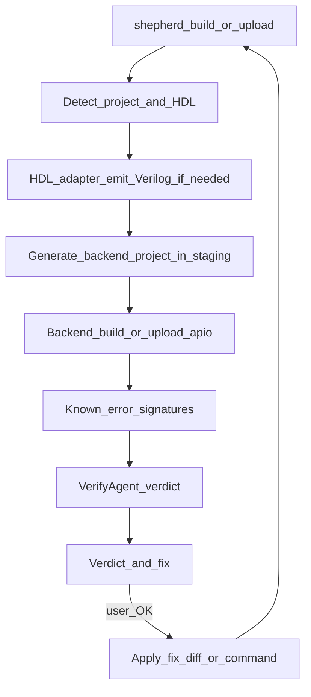

# FPGA Shepherd — AI-assisted FPGA devkit

## Acronyms

Defined once here; used abbreviated afterward in this document.

| Acronym  | Meaning                                                                          |
| -------- | -------------------------------------------------------------------------------- |
| **AI**   | artificial intelligence                                                          |
| **API**  | application programming interface                                                |
| **CI**   | continuous integration                                                           |
| **CLI**  | command-line interface                                                           |
| **CST**  | constraint file (Gowin `.cst` pin constraints)                                   |
|          |                                                                                  |
| **EDA**  | electronic design automation                                                     |
| **FPGA** | field-programmable gate array                                                    |
| **HDL**  | hardware description language                                                    |
|          |                                                                                  |
| **I/O**  | input/output                                                                     |
|          |                                                                                  |
| **OS**   | operating system                                                                 |
| **P&R**  | place and route                                                                  |
| **RTL**  | register-transfer level                                                          |
| **SRAM** | static random-access memory                                                      |
| **SV**   | SystemVerilog                                                                    |
| **UART** | universal asynchronous receiver-transmitter                                      |
|          |                                                                                  |
| **USB**  | Universal Serial Bus                                                             |
| **UX**   | user experience                                                                  |
| **VHDL** | VHSIC Hardware Description Language (VHSIC = very high speed integrated circuit) |
| **YAML** | YAML Ain’t Markup Language (human-readable data format)                          |


## Goal

Ship a **hackathon-ready devkit** for people who already write **register-transfer level (RTL)** designs: they bring their own design, Shepherd takes care of the annoying parts around it.

**Shepherd is the interface.** Users learn Shepherd’s commands, Shepherd’s project file and Shepherd’s output — nothing else. Under the hood, Shepherd drives **[apio](https://fpgawars.github.io/apio/docs)** as its build backend (toolchain install, board definitions, synthesis / **place and route (P&R)** / pack / program). apio is an implementation detail: users never need to know it exists, install it, run it, or edit its files.

What Shepherd gives the user:

1. **Right hardware description language (HDL) adapter for your design** — Verilog/SystemVerilog (**SV**) build directly; Amaranth (and later **VHDL**, SpinalHDL, Chisel) are elaborated to Verilog first
2. **Failure diagnosis** — Yosys / nextpnr / openFPGALoader output turned into a cause + concrete fix (Meta Llama, after deterministic matchers)
3. **Environment fixing** — toolchain, drivers, udev, **Universal Serial Bus (USB)** detection; Shepherd proposes the exact fix and runs it with the user’s OK
4. **Project adoption** — point Shepherd at an existing repo; it detects HDL, top module, sources and constraints and writes `shepherd.toml`

**Audience:** competent **field-programmable gate array (FPGA)** / digital-design engineers. Not a “describe your idea in English” app builder.
**v0 board support: Tang Nano 9K only.** Board/part/programmer facts come from the backend (apio) — Shepherd does not ship board or pin **YAML** registries.

## Pitch

> You write the RTL — in whatever HDL you use. Shepherd picks the right HDL adapter, builds and flashes your board, and when something breaks it tells you why and how to fix it.

## Design principles

- **Interface-first.** Shepherd’s **command-line interface (CLI)**, `shepherd.toml` and output are the product. No backend command, file or term appears in the normal flow — not in help text, prompts, errors, fixes or docs’ quickstart
- **apio is an under-the-hood module.** All backend calls go through one `backend/` package behind a stable `Backend` protocol. Nothing outside `backend/apio/` knows apio exists, so the backend can be pinned, upgraded or swapped (e.g. a vendor-flow backend later) without changing the interface
- **The backend does the toolchain and board work.** Shepherd never re-implements synthesis, P&R, packing, programming, or board/pin databases. Bugs or missing boards in apio go upstream, not into Shepherd
- **Drive the apio CLI, don’t import its internals.** apio is called as a subprocess; its Python internals are not a stable **application programming interface (API)**. Version pinned and checked by `doctor`
- **Translate, don’t leak.** apio’s own messages and hints (e.g. “run `apio drivers …`”) are rewritten into Shepherd terms (“run `shepherd doctor --fix`”). Raw *toolchain* logs (Yosys, nextpnr, openFPGALoader) stay available because experienced users want them — those are the tools, not the backend
- **Transparent on request.** `-v` streams raw toolchain output; `--show-backend` / `--dry-run` print the exact underlying commands. Default output is Shepherd’s steps + verdict
- **Deterministic first, artificial intelligence (AI) second.** HDL-adapter choice, flags and known error signatures are plain code. Meta Llama explains, prioritizes and handles the long tail — it never silently picks flags
- **Never mutate the user’s project without consent.** AI-proposed edits (`.cst` constraint files, `shepherd.toml`, source) are shown as diffs and applied only on confirmation
- **Works offline.** `--no-ai` runs everything except explanations; deterministic checks still fire

## Product shape

A small **Python CLI package** (`fpga-shepherd`, command `shepherd`):

- Shepherd’s own command set (`build`, `upload`, `lint`, `sim`, `test`, `report`, `doctor`, `init`, `explain`, `ask`); each command = HDL adapter → backend step → verify + diagnose
- Talks to **Meta Llama** (`META_API_KEY` + `META_BASE_URL` + model id via env), OpenAI-compatible client over **Hypertext Transfer Protocol (HTTP)**
- Uses `**uv**` for its own env; **apio is a pinned dependency** of the package (`uv add apio`), installed automatically with Shepherd — the user never installs it separately
- Machine-readable output (`--json`) for **continuous integration (CI)** and editor integrations
- Extensible: new HDL adapter / error signature / agent / backend = new module + registration

## Primary flow



Example (experienced user, existing SystemVerilog repo; default output):

```text
$ shepherd build
→ project: SystemVerilog, top=blinky, board=tangnano9k
→ synth   ok
→ pnr     FAIL
→ verdict: FAIL  (signature: nextpnr-unconstrained-io)
   cause: port `uart_tx` has no IO_LOC in tangnano9k.cst
   fix:   add `IO_LOC "uart_tx" 17;` (on-board USB–UART TX) — apply? [y/N]
   log:   .shepherd/runs/2026-10-30T14-02-11/pnr.log   (or re-run with -v)
```

Pin / constraint / board mistakes are surfaced by the toolchain (nextpnr / openFPGALoader) and interpreted by VerifyAgent — Shepherd does not pre-validate against a local pin database.

## Backend layer (apio, hidden)

```text
shepherd CLI ─┬─ HDL adapters ──► staging dir (.shepherd/build/)
              └─ Backend protocol ──► backend/apio/  ──► apio CLI ──► yosys / nextpnr / gowin_pack / openFPGALoader
```

`Backend` protocol (the only thing the rest of Shepherd sees):

| Method | apio implementation |
| --- | --- |
| `ensure_toolchain()` | `apio packages list/install` |
| `boards()` / `resolve_board(name)` | `apio boards` (friendly name ↔ apio board id) |
| `write_project(stage_dir, board, top, sources)` | `apio create` / generated `apio.ini` |
| `build()` / `upload(flash=…)` | `apio build` / `apio upload` |
| `lint()` / `sim()` / `test()` / `report()` | matching apio commands |
| `devices()` / `install_drivers(kind)` | `apio devices` / `apio drivers install` |
| `version()` | `apio --version` |

Rules:

- `**apio.ini` is generated, never user-owned.** It is written into `.shepherd/build/` from `shepherd.toml` on every run; users don’t see or edit it
- **Board names are Shepherd’s.** Users write `board = "tangnano9k"`; the apio backend resolves it to `sipeed-tang-nano-9k` and validates it against `apio boards`. v0 accepts only Tang Nano 9K
- **Output translation lives in `backend/apio/translate.py`.** apio-specific hints, command names and paths are mapped to Shepherd equivalents before anything reaches the user or the LLM prompt
- apio facts the backend must respect (apio 1.6 CLI): sources are taken in lexicographic order, `*_tb.v` / `*_tb.sv` are ignored for build, top module comes from `top-module`, `upload` builds implicitly
- **Escape hatch (advanced, not in main help):** `shepherd backend -- <args>` runs the backend directly in the staging project, for debugging Shepherd itself

## Auto-check policy (VerifyAgent)

After **every** `build`, `upload`, `lint`, `test` (and on demand via `shepherd check`), Shepherd runs VerifyAgent unless `--no-check`.

| After | Deterministic facts | AI adds |
| --- | --- | --- |
| **HDL adapter** | emitter exit code, Verilog produced, top module present | why elaboration failed, in source terms |
| **build** | backend exit code, bitstream exists & non-empty, utilization/timing from `report` | cause + fix for synth/P&R failures; auto re-run with verbose synth/P&R when output is too thin |
| **upload** | openFPGALoader output, device scan, **static random-access memory (SRAM)** vs flash | driver / udev / cable / board-mode fixes, phrased as `shepherd doctor --fix` steps |
| **lint / test** | Verilator / testbench exit codes | grouped, deduplicated findings |

Rules:

- Verdict is `pass` / `warn` / `fail` + fix list; `fail` stops the pipeline
- Known error signatures (`knowledge/errors/*.yaml`, regex + explanation + fix) are matched **before** calling the **large language model (LLM)**; an LLM-diagnosed error that recurs is a candidate for a new signature
- Fix suggestions are always Shepherd commands or project edits — never backend commands
- The LLM gets: the step run, trimmed (translated) logs, `shepherd.toml`, `.cst`, and relevant source snippets — never the whole repo by default
- `shepherd explain [LOGFILE]` diagnoses the last run or any pasted log

## Agents (small, step-aligned)

Fewer agents than a chat-app design: most of the pipeline is deterministic tools; agents exist where judgment helps.

| Agent | Responsibility | Acts via |
| --- | --- | --- |
| **Shepherd** (orchestrator) | Run the pipeline for a command; always invoke VerifyAgent after steps; write the run record | Tool dispatch, no chat by default |
| **DoctorAgent** | Check Python/uv, toolchain, drivers, udev, connected devices; propose exact fix commands | `Backend.ensure_toolchain/devices/install_drivers` + shell checks |
| **AdoptAgent** | Adopt an existing repo: detect HDL(s), candidate top modules, sources/testbenches, `.cst`; propose `shepherd.toml` (imports an existing `apio.ini` if one is found) | Filesystem scan + `Backend.resolve_board` |
| **VerifyAgent** | Verdict after each step: deterministic facts + signature match + Meta Llama diagnosis | Log parsers, `Backend.report`, signature **database (DB)** |

`shepherd ask "..."` is an optional Q&A mode with the project and last run as context (e.g. “why is fmax 27 MHz?”). It is a helper, not the main entry point.

## HDL adapters

An **HDL adapter** converts the user’s design language into something the backend can build (almost always Verilog). The open flow speaks Verilog/SV; other languages need a conversion step first. This is not a **user interface (UI)**.

| HDL | v0 path | Status |
| --- | --- | --- |
| Verilog (`.v`) | passthrough adapter | v0 |
| SystemVerilog (`.sv`) | passthrough adapter (Yosys SV support) | v0 — verify which SV constructs the bundled Yosys accepts; surface clear errors |
| Amaranth (`.py`) | Amaranth elaborate → Verilog into staging dir | v0 |
| VHDL | GHDL synth → Verilog (or ghdl-yosys-plugin) | stretch — verify GHDL availability alongside the backend toolchain |
| SpinalHDL / Chisel | run user’s generator → Verilog | later |

Mixed-language projects: each non-Verilog source is emitted to Verilog, then everything is built as one project.

**Staging:** every build happens in `.shepherd/build/` (generated/copied `.v`, copied **constraint (`.cst`)** files, generated backend project file), so the user’s tree only ever contains their sources and `shepherd.toml`.

## Boards

- **No** `boards.yaml`, **no** `lib/pins/*.yaml`, **no** Shepherd board registry
- Project board lives in `**shepherd.toml**` (`board = "tangnano9k"`). The backend resolves and validates it (apio board definitions)
- Pin / part / programmer knowledge for *build* comes from the backend’s board definitions and toolchain errors
- Adding another board later = backend supports it + we lift the v0 allowlist — no Shepherd catalog to maintain

### Knowledge files + datasheets

`knowledge/` is for **human/LLM reference**, not for replacing the backend. Each supported board (v0: Tang Nano 9K) should identify the **correct datasheets** so diagnosis and `shepherd ask` cite the right docs.

Suggested front matter in `knowledge/tangnano9k.md` (or a small sibling `knowledge/tangnano9k.datasheets.yaml` if we want structured lookup):

```yaml
# example structured block (keep in knowledge/, not a board registry)
board: tangnano9k
datasheets:
  - id: gowin-gw1nr-9
    title: GW1NR-9 / GW1NR series FPGA datasheet
    role: fpga_device          # fpga_device | board | peripheral | programming
    url: https://...          # canonical vendor URL
    mirrors: []               # optional local path or alternate URL
    notes: Use for pin banks, IO standards, timing
  - id: sipeed-tang-nano-9k-schematic
    title: Tang Nano 9K schematic / board doc
    role: board
    url: https://...
    notes: On-board LED / universal asynchronous receiver-transmitter (UART) / button net names
```

Rules:

- Prefer **vendor URLs + document title/version** over pasting datasheet text into the repo
- Agents must resolve datasheets by `board` + `role` (e.g. pin / **input/output (I/O)** question → `board` + `fpga_device`)
- Do not invent electrical facts from memory when a datasheet entry exists — point to it

## Project config

- `**shepherd.toml**` is the only project file users write: board, top module, sources, HDL adapters, constraints, AI on/off
- The backend project file (`apio.ini`) is generated in staging from it and is not user-facing

```toml
board = "tangnano9k"
top = "blinky"
sources = ["rtl/**/*.sv"]
constraints = "tangnano9k.cst"

[adapters]
amaranth = { entry = "rtl/top.py:Top" }

[checks]
ai = true
```

## Run record (replaces chat session context)

Every run writes `.shepherd/runs/<timestamp>/` (`run.json` + per-step logs):

```text
{
  command,            # e.g. build
  project_path,
  board,              # Shepherd board name (e.g. tangnano9k)
  hdl,                # detected languages
  steps: [            # hdl_adapter | synth | pnr | pack | upload | verify
    { name, exit_code, log_path, duration, backend_cmd }   # backend_cmd shown only with --show-backend
  ],
  artifacts,          # emitted .v, .cst, bitstream
  verdict,            # pass | warn | fail
  findings,           # signature matches + AI diagnosis + proposed fixes
  backend: { name, version }   # e.g. apio 1.6.0 — for bug reports, not UX
}
```

`shepherd explain` and `shepherd ask` read the latest run record.

## CLI

| Command | Does |
| --- | --- |
| `shepherd doctor [--fix]` | Env + toolchain + drivers + devices checklist; `--fix` proposes/runs fixes with confirmation |
| `shepherd init [PATH]` | Adopt existing repo (AdoptAgent) or create a minimal project; writes `shepherd.toml` |
| `shepherd build` | HDL adapter → build → verify |
| `shepherd upload [--flash]` | HDL adapter → build + program (SRAM by default) → verify |
| `shepherd lint` / `sim` / `test` / `report` | HDL adapter → matching step → verify where useful |
| `shepherd check --stage …` | VerifyAgent on the last run |
| `shepherd explain [LOG]` | Diagnose last failure or any log |
| `shepherd ask "…"` | Optional Q&A with project + last run as context |

Global flags: `--no-ai`, `--no-check`, `--json`, `--dry-run` (print underlying commands only), `--show-backend`, `-v` (stream raw toolchain output).

Advanced / hidden: `shepherd backend -- <args>` (see Backend layer).

## Default technical decisions

- **Language**: Python 3.11+
- **Env / packaging**: `**uv`** only (`uv sync`, `uv add`, `uv run`); `uv.lock` committed
- **Backend**: apio (pinned, `>=1.6,<2`) behind `backend/`; toolchain packages installed by `shepherd doctor`
- **LLM**: Meta Llama via OpenAI-compatible HTTP client behind `llm/client.py`
- **Agent loop**: lightweight ReAct-style loop per agent; no heavy framework
- **Operating system (OS)**: macOS + Linux for v0; Windows later
- **Secrets**: `.env.example` only; never commit keys
- **Credit**: README acknowledges apio as the build backend and we respect its license — hidden from the workflow, not from the **user experience (UX)** of the normal flow

### How teammates start

```bash
cd FPGA-shepherd
uv sync
cp .env.example .env        # set META_API_KEY
uv run shepherd doctor      # installs/validates the FPGA toolchain with your OK
cd examples/blinky_sv && uv run shepherd upload
```

## Proposed repo layout

```text
PLAN.md
README.md
pyproject.toml              # uv-managed; depends on apio (backend)
uv.lock
.env.example
src/shepherd/
  __init__.py
  cli.py
  config.py                 # shepherd.toml read/write
  runs.py                   # run records
  llm/client.py
  backend/
    base.py                 # Backend protocol (only interface the rest of Shepherd uses)
    apio/
      runner.py             # subprocess wrapper, version check, log capture
      project.py            # generate apio.ini in staging; board name resolution
      parse.py              # apio / yosys / nextpnr / openFPGALoader output parsing
      translate.py          # rewrite apio hints/commands into Shepherd terms
  adapters/                 # HDL adapters (not a UI)
    base.py                 # protocol: detect(), emit() -> Verilog
    verilog.py              # passthrough (.v / .sv)
    amaranth.py
    vhdl.py                 # stretch
  checks/
    artifacts.py            # bitstream / log artifact presence checks
  agents/
    base.py
    shepherd.py             # orchestrator
    doctor.py
    adopt.py
    verify.py
  knowledge/
    tangnano9k.md           # board context for LLM + datasheet pointers
    errors/                 # known error signatures (regex → cause → fix, in Shepherd terms)
      yosys.yaml
      nextpnr.yaml
      openfpgaloader.yaml
      backend.yaml          # apio-specific messages → Shepherd explanations
examples/
  blinky_sv/                # plain SystemVerilog (SV) + shepherd.toml
  uart_amaranth/            # Amaranth HDL adapter (UART demo)
  broken/                   # intentionally broken projects for demo + tests
docs/extending.md           # new HDL adapter / signature / agent / backend
```

## Extensibility

- **HDL adapter** protocol: `detect(project) -> bool`, `emit(project, out_dir) -> list[Path]`
- **Backend** protocol: see Backend layer; apio is the only v0 implementation
- **Error signature**: YAML entry (tool, regex, cause, fix template in Shepherd terms) — no code
- **Agent** protocol: `name`, `system_prompt`, `tools`, `run(context) -> AgentResult`
- **Board**: whatever the backend supports, enabled via Shepherd’s allowlist

## Out of scope for v0

- Re-implementing anything the backend does (toolchain install, synth/P&R, programming, board/pin databases)
- Exposing apio to users (commands, `apio.ini`, terminology) in the normal workflow
- Shepherd-owned pin or board YAML
- Natural-language → design scaffolding (possible later as an optional `shepherd new --describe`)
- Boards other than Tang Nano 9K
- Additional backends (e.g. Gowin vendor **electronic design automation (EDA)**) — the protocol allows it later
- Windows polish
- Auto-applying AI fixes without confirmation
- Claiming functional correctness — Shepherd checks build/program health; behavior is the user’s testbench’s job (`shepherd test` runs it)

## Hackathon demo script

1. `shepherd doctor` on a fresh machine → missing toolchain / driver → fixed with one confirmation
2. `shepherd init` on an existing SV repo → detected top + board → `shepherd.toml` → builds
3. `examples/broken/` with a bad constraint / unconstrained port → P&R fails → `shepherd explain` proposes a fix diff
4. Amaranth project → `shepherd upload` → emitted Verilog → board blinks / UART prints
5. A nextpnr failure with an unknown signature → `shepherd explain` → Meta Llama (**LLM**) diagnosis next to the raw log
6. (Optional, for judges) `--show-backend` to reveal the apio + toolchain commands underneath

## Implementation order

1. Update `**PLAN.md**` (this document)
2. Scaffold package with `uv` (`pyproject.toml`, `uv.lock`, CLI, `.env.example`); `uv add apio`
3. `backend/base.py` + `backend/apio/` (runner, staging project generation, board resolution) + `runs.py`; `build` / `upload` with log capture
4. `backend/apio/translate.py` + error signature DB + VerifyAgent (deterministic, then LLM) + `shepherd explain`
5. DoctorAgent + `doctor --fix`
6. HDL adapters: Verilog/SV passthrough, Amaranth; AdoptAgent + `shepherd init`
7. Examples (incl. `broken/`) + README quickstart + `docs/extending.md`
8. Smoke test: `doctor` → `init` → `build` → `upload` on hardware; `--no-ai`, `--json`, `--show-backend` paths; grep user-facing output for “apio” leaks

## Success criteria

- A user goes from clone to a programmed Tang Nano 9K without ever typing, reading or installing anything called apio
- Experienced user runs `shepherd init` + `shepherd build` / `upload` in an existing Tang Nano 9K repo; the only project file they touch is `shepherd.toml`
- Every run shows Shepherd’s steps and a `pass` / `warn` / `fail` verdict with concrete next steps in Shepherd terms; raw toolchain logs one flag away
- An Amaranth project builds and programs without the user wiring up the conversion
- `shepherd doctor` gets a fresh macOS/Linux machine from nothing to a programmed board with only confirmations
- `--no-ai` works for everything except explanations
- Swapping or upgrading the backend touches only `backend/`; adding an HDL adapter or error signature needs no core changes
