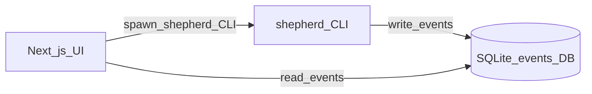

# FPGA Shepherd — UI plan

Companion to [`PLAN.md`](PLAN.md). This document covers the optional **web user interface (UI)** for demos and later product polish.

## Goal

A light **Next.js** UI that shows Shepherd runs live: steps, verdicts, logs, ask/explain, and (later) waveforms — without inventing a second backend.

**Demo rule:** no FastAPI (or other **application programming interface (API)** server) between Python and the UI. Shepherd and the UI both talk to a shared **SQLite** events database (**DB**).

## Acronyms

Same glossary as [`PLAN.md`](PLAN.md). Extra for this file:

| Acronym | Meaning |
| --- | --- |
| **SSE** | server-sent events (not used in v0 demo path) |
| **VCD** | value change dump (simulation waveform file) |
| **WASM** | WebAssembly |

## Architecture (demo-simple)



- **Shepherd (Python)** is still the only thing that runs builds, uploads, adapters, and AI diagnosis. Every meaningful step appends rows to the shared events DB (and keeps `.shepherd/runs/` files as today).
- **Next.js** reads those rows for the live run view. To *start* a command, the UI spawns `uv run shepherd …` as a subprocess (or queues a row that a tiny local watcher runs — spawn is enough for the hackathon).
- **No FastAPI**, no separate HTTP job API, no duplicate toolchain logic in Node.

Why SQLite: one file, works from Python and from Next.js (server-side), zero deploy complexity for a laptop demo.

## Shared events DB

**Path (default):** `.shepherd/shepherd.db` in the project being worked on (or a path in `shepherd.toml` / env for multi-project demos).

**WAL mode** on so the UI can read while Shepherd writes.

### Tables (v0)

```sql
-- one row per shepherd invocation
CREATE TABLE runs (
  id            TEXT PRIMARY KEY,   -- uuid or timestamp id
  project_path  TEXT NOT NULL,
  command       TEXT NOT NULL,      -- build | upload | doctor | …
  board         TEXT,
  started_at    TEXT NOT NULL,
  finished_at   TEXT,
  verdict       TEXT,               -- pass | warn | fail | null while running
  meta_json     TEXT                -- optional JSON blob
);

-- append-only stream both sides poll
CREATE TABLE events (
  id         INTEGER PRIMARY KEY AUTOINCREMENT,
  run_id     TEXT NOT NULL REFERENCES runs(id),
  ts         TEXT NOT NULL,
  kind       TEXT NOT NULL,        -- step_start | step_end | log | verdict | ask | artifact
  step       TEXT,                 -- synth | pnr | upload | verify | …
  level      TEXT,                 -- info | warn | error
  message    TEXT,
  payload_json TEXT,               -- structured extras
  FOREIGN KEY (run_id) REFERENCES runs(id)
);

CREATE INDEX idx_events_run_id ON events(run_id);
CREATE INDEX idx_events_id ON events(id);
```

Shepherd writes; the UI polls `SELECT * FROM events WHERE id > ? ORDER BY id` (simple cursor). No WebSockets required for v0.

Optional later: `command_requests` table if we want the UI to enqueue work without spawning — **out of scope for first demo**.

## Next.js app

**Location:** `web/` at the repo root.

**Stack (keep light):**

| Piece | Choice | Why |
| --- | --- | --- |
| App | Next.js (App Router) | Familiar, fast to ship UI |
| Language | TypeScript | Safer for a team hackathon |
| Styling | One small system (e.g. CSS modules or Tailwind) | Don’t over-design |
| DB access | `better-sqlite3` (or equivalent) **only in Server Components / Route Handlers / Server Actions** | “Read DB directly” without a Python HTTP layer |
| Live updates | Poll events every ~200–500 ms while a run is active | Demo-simple |
| Charts / scope | See Waveforms below | Don’t pull heavy dashboards |

## What we show in the UI

Think of the UI as a **control room for Shepherd**, not a full IDE and not a second toolchain.

### Screens (v0 — ship for demo)

| Screen | What the user sees | Data source |
| --- | --- | --- |
| **Project** | Project path, board (`tangnano9k`), top module, sources summary, last verdict badge | `shepherd.toml` + latest `runs` row |
| **Run (live)** | Step timeline (adapter → synth → P&R → pack → upload → verify), scrolling log lines, current step highlight, final **pass / warn / fail** + fix list | `events` table (poll) |
| **Doctor** | Checklist items turning green/red; “Fix” button that spawns `shepherd doctor --fix` | `events` from a doctor run |
| **Explain** | Last failure cause + proposed fix (Shepherd terms); optional “apply diff?” confirmation later | `events` kind `verdict` / ask payloads + log paths |
| **Ask** | Simple prompt box; answer streamed/written as events | spawn `shepherd ask "…"` → events |
| **Artifacts** | Clickable list: log files, bitstream `.fs`, emitted Verilog, sim **VCD** (when present) | `artifact` events with **file paths** (not file blobs in the DB) |

Optional toggle: **Show backend commands** — reveals underlying tool lines for judges; default off.

### Screens (v0.5 — waveforms)

| Screen | What the user sees |
| --- | --- |
| **Waveforms (sim)** | After `shepherd sim`, an embedded **Surfer** view of the **VCD**/FST file for that run (zoom, cursors, digital channels) |
| **Scope (UART) — later** | Strip chart of samples from the board (LEDs/UART payload decoded), not a full lab oscilloscope |

### What we deliberately do *not* show (v0)

- Raw apio / nextpnr walls of text as the primary UX (logs available via Artifacts / `-v`-equivalent)
- Full code editor / project tree like VS Code (users keep their editor)
- Live FPGA pin probe without a capture path (sim VCD or UART stream first)

### Example Run screen (illustrative)

```text
Project: examples/blinky_sv    board: tangnano9k    top: blinky

[ Build ]  [ Upload ]  [ Sim ]  [ Doctor ]  [ Explain ]

Steps
  ✓ HDL adapter
  ✓ synth
  ✗ pnr          ← selected
  · pack
  · upload
  · verify

Log (pnr)
  … ERROR: port uart_tx unconstrained …

Verdict: FAIL
  cause: port `uart_tx` has no IO_LOC in tangnano9k.cst
  fix:   add IO_LOC "uart_tx" 17; — [Apply?] [Copy]

Artifacts: pnr.log  |  (no bitstream)
```

## Triggering Shepherd from the UI

Server Action / Route Handler:

1. Insert or prepare run context if needed  
2. `spawn('uv', ['run', 'shepherd', 'build'], { cwd: projectPath })`  
3. Shepherd itself creates the `runs` row and streams `events`  
4. UI polls until `runs.finished_at` is set  

Do **not** reimplement build in Node. Do **not** call apio from the UI.

## Waveforms (“oscilloscope”) — yes, we can show them

**Yes** — for simulation waveforms and (later) simple live traces. Important split:

| Kind | How we show it | In SQLite? |
| --- | --- | --- |
| **Sim waveforms (VCD/FST)** | Shepherd runs `sim` → writes file under `.shepherd/…` → DB stores an **`artifact` event with the path** → UI embeds **Surfer (WASM)** pointed at that file | Path + metadata only |
| **Build/run progress** | Event feed on Run screen | Yes — small text rows |
| **Live UART “scope”** | Shepherd (or a helper) appends samples; UI plots with **uPlot** / canvas | Optional small sample table *or* a side file (CSV/binary) + path in DB |

**Do not** put multi‑MB VCD blobs inside SQLite. Waveform engines want a file (or memory map); the DB only points at it.

Phasing:

| Phase | Ship |
| --- | --- |
| **v0** | Run / Doctor / Explain / Ask / Artifacts (paths) — **no** waveform viewer required |
| **v0.5** | **Sim waveforms** via Surfer embed when a VCD artifact exists |
| **later** | Live UART strip chart |

## Database choice

**SQLite is enough** for the demo event bus (runs + events + artifact paths). Easy for Python and Next.js, one file next to the project, no server.

| Need | Recommendation |
| --- | --- |
| Run steps, logs lines, verdicts, ask text | **SQLite** (default) |
| VCD / bitstream / big logs | **Files on disk**; DB holds path |
| Live UART at modest rate | SQLite sample table **or** append-only file; still fine for hackathon |
| Multi-user / remote UI later | Then consider Postgres — **not** required now |

Other easy DBs if we outgrow SQLite *for events only*: **DuckDB** (same “file DB” feel, great analytics, overkill for v0) or **Postgres** via Docker (more moving parts). Stay on **SQLite** unless we hit concurrent-writer pain or remote multi-client needs.

**Default decision:** SQLite for events; files for waveforms and bitstreams; Surfer for viewing sim waveforms.

## Repo layout (UI-related)

```text
PLAN.md
PLAN_UI.md                  # this file
web/                        # Next.js app
  package.json
  src/app/...
  src/lib/db.ts             # open .shepherd/shepherd.db (read + poll)
  src/lib/spawnShepherd.ts  # spawn uv run shepherd …
src/shepherd/
  events/
    db.py                   # open/migrate SQLite, append events
    schema.sql
  ...
```

## What stays in PLAN.md vs here

| Concern | Document |
| --- | --- |
| CLI, apio backend, agents, adapters, Tang Nano 9K | [`PLAN.md`](PLAN.md) |
| Next.js screens, SQLite event schema, polling, Surfer/uPlot | **this file** |
| Shared decision: **no FastAPI; shared SQLite events** | both (brief in PLAN.md, detail here) |

## Out of scope for UI v0

- FastAPI / Express / tRPC job API as the integration layer  
- Electron / Tauri packaging  
- Multi-user auth / hosted cloud DB  
- Replacing Surfer with a custom full waveform engine  
- Driving apio or openFPGALoader from Node  

## Implementation order (UI)

1. Agree schema; implement `src/shepherd/events/` writers alongside existing run records  
2. Scaffold `web/` Next.js app; read-only Run page polling SQLite  
3. Spawn `shepherd build` / `doctor` from UI  
4. Explain/Ask surfaces  
5. Optional: Surfer embed for sim artifacts  

## Success criteria (UI)

- Demo laptop: run Shepherd from CLI **or** UI; same events appear in the Run view from the DB  
- No FastAPI process in the demo script  
- Judges can follow synth → P&R → verdict without reading raw apio commands  
- Adding waveform view later does not require changing the event bus shape (artifact events already exist)
