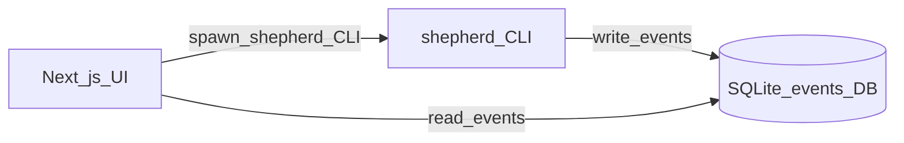

# FPGA Shepherd — UI plan

Companion to [`PLAN.md`](PLAN.md). This document covers the optional **web user interface (UI)** for demos and later product polish.

## Goal

A light **Next.js** UI that shows Shepherd runs live: steps, verdicts, logs, ask/explain, and (later) waveforms — without inventing a second backend.

**Demo rule:** no FastAPI (or other **application programming interface (API)** server) between Python and the UI. Shepherd and the UI both talk to a shared **SQLite** events database (**DB**).

## Acronyms

Same glossary as [`PLAN.md`](PLAN.md). Extra for this file:

| Acronym | Meaning |
| --- | --- |
| **SSE** | server-sent events (not used in v0 demo path) |
| **VCD** | value change dump (simulation waveform file) |
| **WASM** | WebAssembly |

## Architecture (demo-simple)



- **Shepherd (Python)** is still the only thing that runs builds, uploads, adapters, and AI diagnosis. Every meaningful step appends rows to the shared events DB (and keeps `.shepherd/runs/` files as today).
- **Next.js** reads those rows for the live run view. To *start* a command, the UI spawns `uv run shepherd …` as a subprocess (or queues a row that a tiny local watcher runs — spawn is enough for the hackathon).
- **No FastAPI**, no separate HTTP job API, no duplicate toolchain logic in Node.

Why SQLite: one file, works from Python and from Next.js (server-side), zero deploy complexity for a laptop demo.

## Shared events DB

**Path (default):** `.shepherd/shepherd.db` in the project being worked on (or a path in `shepherd.toml` / env for multi-project demos).

**WAL mode** on so the UI can read while Shepherd writes.

### Tables (v0)

```sql
-- one row per shepherd invocation
CREATE TABLE runs (
  id            TEXT PRIMARY KEY,   -- uuid or timestamp id
  project_path  TEXT NOT NULL,
  command       TEXT NOT NULL,      -- build | upload | doctor | …
  board         TEXT,
  started_at    TEXT NOT NULL,
  finished_at   TEXT,
  verdict       TEXT,               -- pass | warn | fail | null while running
  meta_json     TEXT                -- optional JSON blob
);

-- append-only stream both sides poll
CREATE TABLE events (
  id         INTEGER PRIMARY KEY AUTOINCREMENT,
  run_id     TEXT NOT NULL REFERENCES runs(id),
  ts         TEXT NOT NULL,
  kind       TEXT NOT NULL,        -- step_start | step_end | log | verdict | ask | artifact
  step       TEXT,                 -- synth | pnr | upload | verify | …
  level      TEXT,                 -- info | warn | error
  message    TEXT,
  payload_json TEXT,               -- structured extras
  FOREIGN KEY (run_id) REFERENCES runs(id)
);

CREATE INDEX idx_events_run_id ON events(run_id);
CREATE INDEX idx_events_id ON events(id);
```

Shepherd writes; the UI polls `SELECT * FROM events WHERE id > ? ORDER BY id` (simple cursor). No WebSockets required for v0.

Optional later: `command_requests` table if we want the UI to enqueue work without spawning — **out of scope for first demo**.

## Next.js app

**Location:** `web/` at the repo root.

**Stack (keep light):**

| Piece | Choice | Why |
| --- | --- | --- |
| App | Next.js (App Router) | Familiar, fast to ship UI |
| Language | TypeScript | Safer for a team hackathon |
| Styling | One small system (e.g. CSS modules or Tailwind) | Don’t over-design |
| DB access | `better-sqlite3` (or equivalent) **only in Server Components / Route Handlers / Server Actions** | “Read DB directly” without a Python HTTP layer |
| Live updates | Poll events every ~200–500 ms while a run is active | Demo-simple |
| Charts / scope | See Waveforms below | Don’t pull heavy dashboards |

**Pages / areas (v0):**

1. **Project** — path to `shepherd.toml`, board, top, last verdict  
2. **Run** — live event feed (steps + log lines + verdict)  
3. **Doctor** — trigger `shepherd doctor`, show checklist events  
4. **Explain / Ask** — show AI findings from events; trigger `shepherd explain` / `shepherd ask` via CLI spawn  
5. **Artifacts** — links to log files / bitstream paths from `payload_json`

Advanced “show backend” can be a toggle that reveals `backend_cmd` fields from payloads — still Shepherd terms by default.

## Triggering Shepherd from the UI

Server Action / Route Handler:

1. Insert or prepare run context if needed  
2. `spawn('uv', ['run', 'shepherd', 'build'], { cwd: projectPath })`  
3. Shepherd itself creates the `runs` row and streams `events`  
4. UI polls until `runs.finished_at` is set  

Do **not** reimplement build in Node. Do **not** call apio from the UI.

## Waveforms (“oscilloscope”)

Phased so the demo stays light:

| Phase | Need | Approach |
| --- | --- | --- |
| **v0** | Live run UX | Event feed only — no scope |
| **v0.5** | Sim waveforms | After `shepherd sim`, open / embed **Surfer** (**WASM**) on the **VCD**/FST artifact path stored in an `artifact` event |
| **later** | Live UART samples | Shepherd writes sample events or a side table; UI plots with **uPlot** or canvas |

Do not adopt heavy instrumentation frameworks for the hackathon.

## Repo layout (UI-related)

```text
PLAN.md
PLAN_UI.md                  # this file
web/                        # Next.js app
  package.json
  src/app/...
  src/lib/db.ts             # open .shepherd/shepherd.db (read + poll)
  src/lib/spawnShepherd.ts  # spawn uv run shepherd …
src/shepherd/
  events/
    db.py                   # open/migrate SQLite, append events
    schema.sql
  ...
```

## What stays in PLAN.md vs here

| Concern | Document |
| --- | --- |
| CLI, apio backend, agents, adapters, Tang Nano 9K | [`PLAN.md`](PLAN.md) |
| Next.js screens, SQLite event schema, polling, Surfer/uPlot | **this file** |
| Shared decision: **no FastAPI; shared SQLite events** | both (brief in PLAN.md, detail here) |

## Out of scope for UI v0

- FastAPI / Express / tRPC job API as the integration layer  
- Electron / Tauri packaging  
- Multi-user auth / hosted cloud DB  
- Replacing Surfer with a custom full waveform engine  
- Driving apio or openFPGALoader from Node  

## Implementation order (UI)

1. Agree schema; implement `src/shepherd/events/` writers alongside existing run records  
2. Scaffold `web/` Next.js app; read-only Run page polling SQLite  
3. Spawn `shepherd build` / `doctor` from UI  
4. Explain/Ask surfaces  
5. Optional: Surfer embed for sim artifacts  

## Success criteria (UI)

- Demo laptop: run Shepherd from CLI **or** UI; same events appear in the Run view from the DB  
- No FastAPI process in the demo script  
- Judges can follow synth → P&R → verdict without reading raw apio commands  
- Adding waveform view later does not require changing the event bus shape (artifact events already exist)
